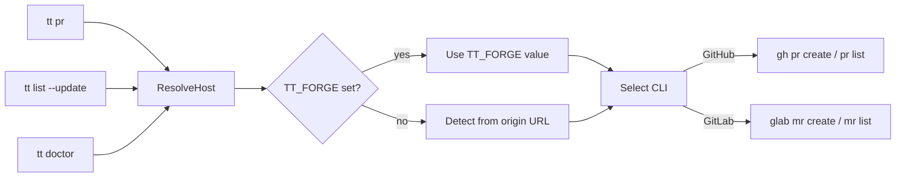

# GitLab 対応コマンド列挙と第1弾スコープ確定

## 背景 (Background)

`tt` の PR 系ワークフローおよび一部の配布・コンテンツ取得処理は、GitHub CLI (`gh`) と GitHub Contents API に固定されている。リモートが GitLab のリポジトリでは、`tt pr` や `tt list` の CodeStatus 更新が動作しない。

本仕様は、GitLab 対応が必要なコマンド／スクリプトを洗い出し、**第1弾で実装する対象を確定する**。実装詳細（ホスト検出と `glab` 置換）は別計画で扱う。

---

## 要件 (Requirements)

### 必須要件（第1弾スコープ）

以下 3 コマンドを GitLab（Merge Request）対応の第1弾対象として確定する。

#### R1: `tt pr` を GitLab MR 作成に対応させること

- 現状: `gh pr create`（[`features/tt/cmd/pr.go`](features/tt/cmd/pr.go) → [`pkg/action/pr.go`](pkg/action/pr.go) → [`internal/github/github.go`](internal/github/github.go) `CreatePR`）
- 第1弾: リモートが GitLab のとき `glab mr create`（または同等）で MR を作成できること
- コマンド名 `tt pr` と状態値 `CodeStatusPR` / `PRCreatedAt` は後方互換のため維持し、GitLab では MR を同一ステータスとして扱う

#### R2: `tt list` / `tt list --update` の PR 判定を GitLab MR 判定に対応させること

- 現状: `gh pr list --head <branch> --json number,createdAt --limit 1`（[`pkg/codestatus/codestatus.go`](pkg/codestatus/codestatus.go) `findPR`）
- 第1弾: リモートが GitLab のとき source branch に紐づく open MR を検出できること
- `git ls-remote` による remote branch 有無判定はホスト非依存のため変更不要

#### R3: `tt doctor` が GitLab 向け CLI を診断できること

- 現状: `gh` の存在チェック（WARN、[`pkg/doctor/checks.go`](pkg/doctor/checks.go)）
- 第1弾: リモートが GitLab のとき `glab` を WARN 対象として診断すること。GitHub のときは従来どおり `gh` を診断すること

#### R4: 共有依存の整理

- `TT_CMD_GH`（デフォルト `gh`）に加え、GitLab 用コマンドオーバーライド（例: `TT_CMD_GLAB`、デフォルト `glab`）を導入すること
- origin remote URL からホスト（GitHub / GitLab）を検出できること
- **明示指定**: URL に `gitlab` 文字列が含まれないセルフホスト等でも、環境変数 `TT_FORGE=gitlab`（または `github`）でホストを強制指定できること
- 解決優先順位: `TT_FORGE`（明示） > origin URL 自動検出 > `unknown`（クライアント選択時は GitHub 経路へフォールバック）

### 任意（本スコープ外・配布レイヤ）

| コマンド/スクリプト | 現状 | 扱い |
|---|---|---|
| `scripts/dist/tool/release.sh` | `gh release list` | ホスト移行時に対応 |
| `scripts/dist/tool/internal/publish.sh` | `gh auth status`, `gh release create` | 同上 |
| `release-note` ツール | `gh release list`、GitHub merge commit 形式 | 同上 |
| bootstrap / Scoop / Homebrew | GitHub Releases URL 固定 | 同上 |

### 対応不要（確定）

- **`tt scaffold` / `tt scaffold --list`**: 取得先は現行どおり GitHub Contents API（`GITHUB_TOKEN` / `gh auth token`）のままとする。本対応でも後続でも変更しない
- `tt open` / `tt close`
- `tt merge`（ローカル `git merge`）
- `tt create` / `tt delete` 等の通常ブランチ操作
- content release の `git push` 本体

### ドキュメント追随（実装と同時に更新）

- [`README.md`](README.md)、[`docs/manual/tt-user-manual.md`](docs/manual/tt-user-manual.md) の `tt pr` / `gh` 説明
- agent 手順の `gh pr create`（`create-pull-request` capability 等）

---

## 実現方針 (Implementation Approach)

1. **スコープ凍結**: 第1弾は `tt pr` / `tt list(--update)` / `tt doctor` と、そのために必要なホスト検出・CLI 解決のみ。
2. **ホスト解決**: まず `TT_FORGE`（`github` / `gitlab`）を見る。未設定なら `git remote get-url origin` の hostname から自動検出する。
3. **CLI 置換**: GitHub は既存 `gh`、GitLab は `glab`（`TT_CMD_GLAB` で上書き可能）。
4. **状態モデル互換**: `status: pr` / `pr_created_at` を MR にも流用し、state ファイルの破壊的変更を避ける。
5. **scaffold は据え置き**: 取得先（GitHub）は変更しない。release 等の任意項目は別仕様で扱う。

---

## 検証シナリオ (Verification Scenarios)

1. コマンド列挙表に、必須・任意・対応不要が漏れなく分類されている。
2. 第1弾対象が `tt pr` / `tt list` / `tt doctor` の 3 コマンドに確定している。
3. `tt scaffold` の取得先を変更しないことが対応不要として明記されている。
4. 第1弾の実装計画が、ホスト検出・`TT_FORGE` 明示指定・`glab`/MR 置換を具体的に記述している。
5. `git.example.com` のような URL でも `TT_FORGE=gitlab` により GitLab 経路になることが計画に含まれる。

---

## テスト項目 (Testing for the Requirements)

本仕様は列挙・スコープ確定が成果物であり、ランタイムコード変更は含まない。検証は以下で行う。

1. 仕様書内の必須表が R1–R4（`TT_FORGE` 明示指定を含む）を満たすこと（レビュー）
2. 後続の実装計画 (`000-GitLab-MR-Support`) が本仕様の R1–R4（明示指定含む）を Requirement Traceability で追跡していること
3. 実装フェーズでは次を実行する（実装計画側に詳細を記載）:
   - `./scripts/process/build.sh`
   - `./scripts/process/integration_test.sh --categories tt --specify "Doctor|List|PR|Forge|GitLab|Host"`
