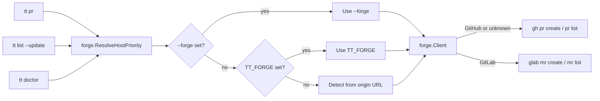

# GitLab Merge Request 対応（tt pr / list / doctor）

## 背景 (Background)

`tt` の Change Request 系ワークフローは GitHub CLI (`gh`) に固定されている。

- `tt pr` → `gh pr create`
- `tt list --update` / `_update-code-status` → `gh pr list --head ...`
- `tt doctor` → `gh` の存在チェック（WARN）

リモートが GitLab のリポジトリでは、これらの操作が動作しない。一方で `tt scaffold` のテンプレート取得先は GitHub Contents API のままでよく、配布・リリーススクリプトも本対応の対象外とする。

本仕様は、[000-GitLab-Command-Inventory.md](file://prompts/phases/000-foundation/branches/feat-adjust-gitlab/ideas/000-GitLab-Command-Inventory.md) で確定した第1弾スコープを、実装可能な要件として具体化する。

---

## 要件 (Requirements)

### 必須要件

#### R1: `tt pr` が GitLab で Merge Request を作成できること

- ホストが GitLab のとき、`glab mr create` を worktree ディレクトリを cwd として対話実行すること
- ホストが GitHub（または unknown）のとき、従来どおり `gh pr create` を実行すること
- コマンド名は `tt pr` のまま維持すること
- 成功時の CodeStatus は従来どおり `status: pr` / `pr_created_at` を記録すること（MR も同一ステータス）

#### R2: `tt list` / `tt list --update` が GitLab の open MR を検出できること

- ホストが GitLab のとき、source branch に紐づく open MR を検出し `CodeStatusPR` にすること
- 検出手段: `glab mr list --source-branch <branch> --output json`（先頭 1 件）。`iid` → number、`created_at` → `PRCreatedAt`
- ホストが GitHub のとき、従来どおり `gh pr list --head <branch> --json number,createdAt --limit 1`
- `git ls-remote` による remote branch 有無判定は変更しないこと
- forge/CLI 失敗時は既存どおり `CodeStatusHosted` にフォールバックすること
- 隠しコマンド `_update-code-status` も同じホスト解決・検出ロジックを使うこと

#### R3: `tt doctor` がホストに応じた CLI を診断すること

- GitHub: `gh` を WARN 対象として診断（従来どおり）
- GitLab: `glab` を WARN 対象として診断
- unknown: `gh` と `glab` の両方を WARN 対象として診断
- `git` / `docker` の必須チェックは変更しないこと

#### R4: ホスト解決と CLI オーバーライド

> **更新**: CLI `--forge` による明示指定は [003-Forge-CLI-Flag-And-Help.md](file://prompts/phases/000-foundation/branches/feat-adjust-gitlab/ideas/003-Forge-CLI-Flag-And-Help.md) が正本。以下はそれに合わせて更新した優先順位。

**ホスト解決の優先順位（確定）:**

1. CLI フラグ `--forge`（明示指定・最優先。`tt pr` / `tt list` / `tt doctor`）
2. 環境変数 `TT_FORGE`（明示指定）
3. `git remote get-url origin` の hostname による自動検出
4. `unknown`（クライアント選択時は GitHub 経路へフォールバック）

**`--forge` / `TT_FORGE`:**

- 値: `github` | `gitlab`（大文字小文字無視）
- 未設定 / 空: オーバーライドなし（次の優先へ）
- 不正な `--forge`: エラー（黙殺しない。`tt doctor` も Fail Fast）
- 不正な `TT_FORGE`: エラー（黙殺しない）。ただし `tt doctor` は診断継続のため unknown 扱いにしてよい
- URL に `gitlab` 文字列が無いセルフホストでも `--forge gitlab` または `TT_FORGE=gitlab` で GitLab 経路にできること

**URL 自動検出:**

- hostname が `github.com`、または `.github.com` で終わる → GitHub
- hostname が `gitlab.com`、または hostname に `gitlab` を含む → GitLab
- それ以外 → unknown
- SSH (`git@host:path`) と HTTPS の両方を扱うこと

**CLI パス:**

- `TT_CMD_GH`（デフォルト `gh`）— 既存
- `TT_CMD_GLAB`（デフォルト `glab`）— 新規

#### R5: ドキュメント更新

- `README.md`、`docs/manual/tt-user-manual.md` に Pull/Merge Request 対応、`TT_FORGE`、`TT_CMD_GLAB` を記載すること

### 任意要件（本仕様の対象外）

| 対象 | 扱い |
|---|---|
| `scripts/dist/tool/release.sh` / `publish.sh` | 対象外 |
| `release-note` ツール | 対象外 |
| bootstrap / Scoop / Homebrew | 対象外 |
| agent 手順の `gh pr create` 文言更新 | 望ましいが必須ではない（本仕様では R5 のユーザー向け文書を優先） |

### 対応不要（確定）

- **`tt scaffold` / `tt scaffold --list`**: 取得先は GitHub Contents API のまま。**変更しない**
- `tt open` / `tt close` / `tt merge` / `tt create` / `tt delete`
- content release の `git push` 本体
- 実 GitLab サーバや実 `glab` ログインを要する `tt pr` 作成 E2E（既存 GitHub にも同等 E2E が無い）

---

## 実現方針 (Implementation Approach)

### アーキテクチャ

新規パッケージ `internal/forge` にホスト解決と Change Request（PR/MR）操作を集約する。



### 主要コンポーネント

1. **`internal/forge`**
   - `Host` (`github` / `gitlab` / `unknown`)
   - `DetectHost` / `ParseForgeOverride` / `ResolveHost` / `DetectHostFromRepo`
   - `Client` インターフェース: `CreateChangeRequest` / `FindOpenChangeRequest`
   - `githubClient`（`gh`）、`gitlabClient`（`glab`）
   - `NewClientForRepo(repoRoot, runner)`
2. **`pkg/action.PR(repoRoot, worktreePath)`** — forge 経由で create
3. **`pkg/codestatus.Checker`** — `Forge` / `Host` / `GlabCmd` を持ち open CR を検索
4. **`pkg/doctor`** — ホストに応じて `gh` / `glab` を WARN 診断
5. **`features/tt/cmd`** — `TT_CMD_GLAB` / `TT_FORGE` を known env に追加。list / update_code_status / pr を接続

### 設計上の決定事項

| 決定 | 内容 |
|---|---|
| 状態モデル | `CodeStatusPR` / `pr_created_at` を MR にも流用（破壊的変更なし） |
| unknown 時の Client | GitHub 経路（後方互換） |
| scaffold | GitHub Contents API / `resolveToken` を触らない |
| `tt pr` 実ホスト E2E | 追加しない。CLI 切替は単体（Recorder）と doctor 統合で証明 |

### データ構造（仕様レベル）

```go
type Host string
const (
    HostGitHub  Host = "github"
    HostGitLab  Host = "gitlab"
    HostUnknown Host = "unknown"
)

const EnvForge = "TT_FORGE"

type ChangeRequestInfo struct {
    Number    int
    CreatedAt time.Time
}

type Client interface {
    Host() Host
    CreateChangeRequest(workDir string) error
    FindOpenChangeRequest(workDir, branch string) (*ChangeRequestInfo, error)
}
```

---

## 検証シナリオ (Verification Scenarios)

1. origin が `https://github.com/org/repo.git` のとき、`tt doctor --json` の外部ツール結果に `gh` が含まれる。
2. origin が `https://gitlab.com/group/proj.git` のとき、`tt doctor --json` の外部ツール結果に `glab` が含まれる。
3. origin が `https://git.example.com/g/p.git`（hostname に `gitlab` なし）かつ `TT_FORGE=gitlab` のとき、`tt doctor --json` に `glab` が含まれる。`--forge gitlab` でも同様。
4. `TT_FORGE=gitlab` または `--forge gitlab` のとき、`tt pr` 経路（単体/Recorder）が `glab mr create` を worktree cwd で呼ぶ。
5. `--forge` / `TT_FORGE` 未設定かつ GitHub URL のとき、`tt pr` 経路が `gh pr create` を呼ぶ（回帰）。
6. GitLab 経路で open MR JSON（`iid` / `created_at`）があるとき、`codestatus.Resolve` が `CodeStatusPR` と `PRCreatedAt` を返す。
7. forge/CLI 失敗時、`codestatus.Resolve` が `CodeStatusHosted` にフォールバックする。
8. `tt scaffold` の取得先・GitHub Contents API 実装が本変更で変わっていない。
9. 不正な `TT_FORGE`（例: `bitbucket`）は create/list 経路でエラーになる（doctor は診断継続可）。不正な `--forge` は doctor も含め Fail Fast。

---

## テスト項目 (Testing for the Requirements)

### 要件と検証の対応

| 要件 | 検証手段 |
|---|---|
| R1 | 単体: `pkg/action/pr_test.go`（Recorder で `gh`/`glab` 切替）。統合: doctor/host でホスト解決の土台を確認 |
| R2 | 単体: `pkg/codestatus/codestatus_test.go`（MR JSON → `CodeStatusPR`、失敗時 hosted） |
| R3 | 単体: `pkg/doctor/checks_test.go`。統合: `tests/tt/tt_forge_host_test.go` |
| R4 | 単体: `internal/forge/host_test.go` / `resolve_test.go`。統合: `TT_FORGE` override ケース |
| R5 | ドキュメント差分レビュー（ビルド成功後） |
| scaffold 据え置き | 差分に `pkg/scaffold` / Contents API 変更が無いこと |

### ビルド・全体検証

1. ビルド＋単体テスト:
   ```bash
   ./scripts/process/build.sh
   ```

2. tt 統合テスト（doctor / list / forge host）:
   ```bash
   ./scripts/process/build.sh && ./scripts/process/integration_test.sh --categories tt --specify "Doctor|List|Forge|GitLab|Host"
   ```

3. scaffold は本変更の検証対象に含めない（取得先未変更・API 依存・長時間）。意図しない回帰が疑われる場合のみ別途実行する。
