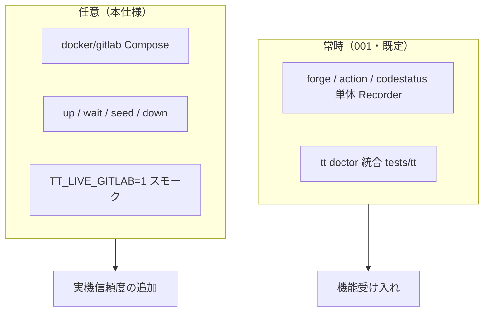

# GitLab Docker 任意ライブ検証基盤

## 背景 (Background)

[001-GitLab-MR-Support.md](file://prompts/phases/000-foundation/branches/feat-adjust-gitlab/ideas/001-GitLab-MR-Support.md) では、`tt pr` / `tt list` / `tt doctor` の GitLab 対応を、`internal/forge` の単体（Recorder）と doctor 統合で証明する方針とした。実 GitLab サーバや実 `glab` ログインを要する `tt pr` 作成 E2E は、既存 GitHub 経路にも同等が無いため対象外としている。

一方で、実装後の信頼度を上げるには、ローカルで GitLab CE を Docker 起動し、`glab` 経由の実応答を確認できる手段が欲しい。この検証は重い（起動数分・メモリ数 GB）ため、デフォルトの `integration_test.sh` / CI には載せられない。リポジトリには「再現可能な起動レシピとシード、任意スモーク手順」だけを置き、秘密情報や永続データは置かない必要がある。

本仕様は、その任意ライブ検証基盤として **何をリポジトリに保存し、何を保存しないか**、およびオプトイン実行の要件を定める。001 の受け入れ条件（単体＋doctor 統合）は変更しない。

---

## 要件 (Requirements)

### 必須要件

#### R1: GitLab CE を Docker で再現起動できること

- リポジトリ内に GitLab CE 用の Compose 定義を置くこと（イメージタグはピン留め）
- 起動・ readiness 待機・停止をシェルスクリプトで実行できること（`--help` 付き）
- ホスト側の公開ポート・必要リソース（目安 RAM）を README に明記すること
- デフォルトの `scripts/process/integration_test.sh`（オプションなし / 通常カテゴリ）からは自動起動しないこと

#### R2: テスト前提をシードで再現できること

- プロジェクト作成、Personal Access Token（または同等の API トークン）発行、検証用ブランチ／リポジトリ初期化を、スクリプトまたは文書化された手順で再現できること
- シード結果として、ローカル GitLab URL・プロジェクトパス・トークン取得方法が分かる出力（または README 手順）があること
- **トークン実値・root パスワード実値・`.env` 実値はリポジトリにコミットしないこと**（`.env.example` や生成先パスの文書化のみ可）

#### R3: 任意スモークで `tt` × 実 GitLab を確認できること

オプトイン時に、少なくとも次を確認できること:

1. origin がローカル GitLab（または `TT_FORGE=gitlab`）のとき、`tt doctor` が `glab` を WARN 対象に含む
2. open MR がある source branch で `tt list --update`（または同等の CodeStatus 更新経路）が `status: pr` / `pr_created_at` 相当になる
3. `tt pr` が `glab mr create` 経由で MR を作成できる（対話を避ける手段があればそれを文書化）

- 実行トリガは環境変数（例: `TT_LIVE_GITLAB=1`）または明示スクリプト呼び出しとし、**未設定時はスキップ**すること
- 001 の「デフォルト経路に実ホスト E2E を追加しない」方針を維持すること

#### R4: リポジトリに保存するもの／しないものを明確にすること

**保存する（必須）:**

| 対象 | 配置の目安 |
|---|---|
| Compose（ピン留めイメージ） | `docker/gitlab/`（または同等の専用ディレクトリ） |
| up / wait-ready / seed / down ラッパ | `scripts/` 配下（例: `scripts/dev/gitlab-*.sh`） |
| 実行手順・前提（RAM、ポート、`glab auth`、`TT_FORGE`） | 当該ディレクトリの `README.md` |
| オプトイン用スモーク（テストまたはチェックリスト＋実行コマンド） | `tests/tt/`（live タグ等）または専用スクリプト |

**保存しない（必須）:**

- Personal Access Token / root パスワード / 認証済み `glab` 設定の実体
- GitLab data volume の中身（DB、uploads、実行時 `gitlab.rb` 変更の永続コピー）
- デフォルト CI / 通常の `integration_test.sh` 必須ジョブとしての GitLab CE 起動

#### R5: 001 との境界

- 本仕様は 001 の機能受け入れを置き換えない（001 の単体・doctor 統合が正）
- `tt scaffold` / release / インストーラは対象外のまま
- forge の本番実装変更が目的ではなく、検証基盤の追加が目的。検証のため最小限のテストハーネス／スクリプトのみ追加してよい

### 任意要件

| 対象 | 扱い |
|---|---|
| CI での手動トリガ／夜間ジョブ | 任意。入れる場合も既定パイプラインをブロックしないこと |
| `tt pr` 以外（コメント投稿等）のライブ検証 | 対象外 |
| GitLab EE 固有機能 | 対象外（CE で十分） |

### 対応不要（確定）

- 001 で除外した実ホスト E2E を、デフォルト統合テストの必須項目へ昇格すること
- GitHub 側の同等ライブ E2E の新設（本仕様のスコープ外）
- GitLab 公式イメージ以外の軽量モック API サーバへの置換（将来検討可だが本仕様では CE 実機）

---

## 実現方針 (Implementation Approach)

### レイヤ分離



1. **常時**: 001 の単体＋doctor 統合のまま機能受け入れとする。
2. **任意**: Docker GitLab を上げ、`glab` 認証後に doctor / list / pr をスモークする。
3. **CI 既定には載せない**: 必要なら別ジョブ・手動のみ。

### 主要コンポーネント

1. **`docker/gitlab/docker-compose.yml`**
   - 公式 GitLab CE イメージをタグピン留め
   - ホスト名・ポート・ボリューム名をローカル検証用に固定（ボリューム中身は gitignore / コミット対象外）
2. **スクリプト**
   - `up`: compose up
   - `wait-ready`: HTTP/API が応答するまで待機（タイムアウト明示）
   - `seed`: プロジェクト・トークン・必要なら初期リポジトリ／ブランチを API で作成。トークンは stdout またはローカル ignore ファイルへ出力
   - `down`: compose down（volume 削除は明示フラグ時のみ推奨）
3. **スモーク**
   - Go テストを build tag または `TT_LIVE_GITLAB` でゲートするか、シェルのスモークスクリプト＋検証観点リストとする
   - 一時 git リポジトリの `origin` をローカル GitLab に向け、`TT_CMD_GLAB` / `glab` 認証済み状態を前提にする
4. **文書**
   - 前提（Docker Desktop、目安メモリ、初回起動時間）、認証手順、トラブルシュート（root パスワード初期取得など）を README に集約

### 設計上の決定事項

| 決定 | 内容 |
|---|---|
| 既定テストへの組込 | しない（オプトインのみ） |
| 秘密情報 | リポジトリ外。example と生成手順のみ |
| イメージ | GitLab CE、タグピン留め |
| 001 との関係 | 補完。001 の「実 E2E 非必須」は維持 |
| 失敗時 | オプトイン未実行は成功扱い（スキップ）。オプトイン実行時の失敗は失敗 |

---

## 検証シナリオ (Verification Scenarios)

1. リポジトリをクローンした状態で、GitLab 用 Compose と up/wait/seed/down スクリプトおよび README が存在する。
2. `up` を実行すると GitLab CE コンテナが起動し、`wait-ready` が成功する（初回は数分かかってよい）。
3. `seed` を実行すると、検証用プロジェクトが作成され、トークン取得方法が分かる（実トークンは git 管理下に残らない）。
4. `glab` をローカル GitLab に対して認証したうえで、一時リポジトリの origin をそのプロジェクトに設定する（必要なら `TT_FORGE=gitlab`）。
5. `tt doctor --json`（または同等）の外部ツール結果に `glab` が含まれる。
6. リモートに source branch を push し open MR を用意したうえで、`tt list --update`（または CodeStatus 更新経路）が当該ブランチを `pr` 相当と判定する。
7. `tt pr` を実行すると MR が作成される（または非対話で同等の成功が確認できる）。
8. `TT_LIVE_GITLAB` 未設定（またはオプトイン未指定）のとき、通常の `integration_test.sh --categories tt` は GitLab CE を起動せず完了する。
9. `down` でコンテナを停止できる。volume を残しても、秘密情報がリポジトリ作業ツリーにコミット対象として現れない。

---

## テスト項目 (Testing for the Requirements)

### 要件と検証の対応

| 要件 | 検証手段 |
|---|---|
| R1 | スクリプト／Compose の存在と `--help`。任意: up→wait-ready→down の手動またはオプトイン自動 |
| R2 | seed 実行後にプロジェクトが存在すること、およびトークン実値が git status に現れないこと（ignore / 非作成） |
| R3 | `TT_LIVE_GITLAB=1`（または同等）時のスモーク: doctor / list--update / pr |
| R4 | リポジトリに secrets・volume 実体が無いこと（パス規約＋ `.gitignore`）。README に保存方針を記載 |
| R5 | 既定の tt 統合が GitLab 起動なしで通ること（001 回帰） |

### ビルド・全体検証

1. ビルド＋単体テスト（001 回帰を含む）:
   ```bash
   ./scripts/process/build.sh
   ```

2. tt 統合（ホスト解決・doctor。GitLab CE は起動しない）:
   ```bash
   ./scripts/process/build.sh && ./scripts/process/integration_test.sh --categories tt --specify "Doctor|List|Forge|GitLab|Host"
   ```

3. オプトイン・ライブ（Docker GitLab 起動後・認証済み環境でのみ）:
   ```bash
   # 例: スクリプト経由
   ./scripts/dev/gitlab-up.sh && ./scripts/dev/gitlab-wait.sh && ./scripts/dev/gitlab-seed.sh
   # 認証後
   TT_LIVE_GITLAB=1 ./scripts/process/integration_test.sh --categories tt --specify "LiveGitLab"
   ```
   （最終的なスクリプト名／テスト名は実装計画で確定。仕様上はオプトイン識別子と `--specify` 絞り込みを必須とする。）

4. 既定経路がライブに依存しないことの確認:
   ```bash
   ./scripts/process/integration_test.sh --categories tt --specify "Doctor|Forge|Host"
   ```
   （この実行中に GitLab コンテナを新規要求しないこと。）
