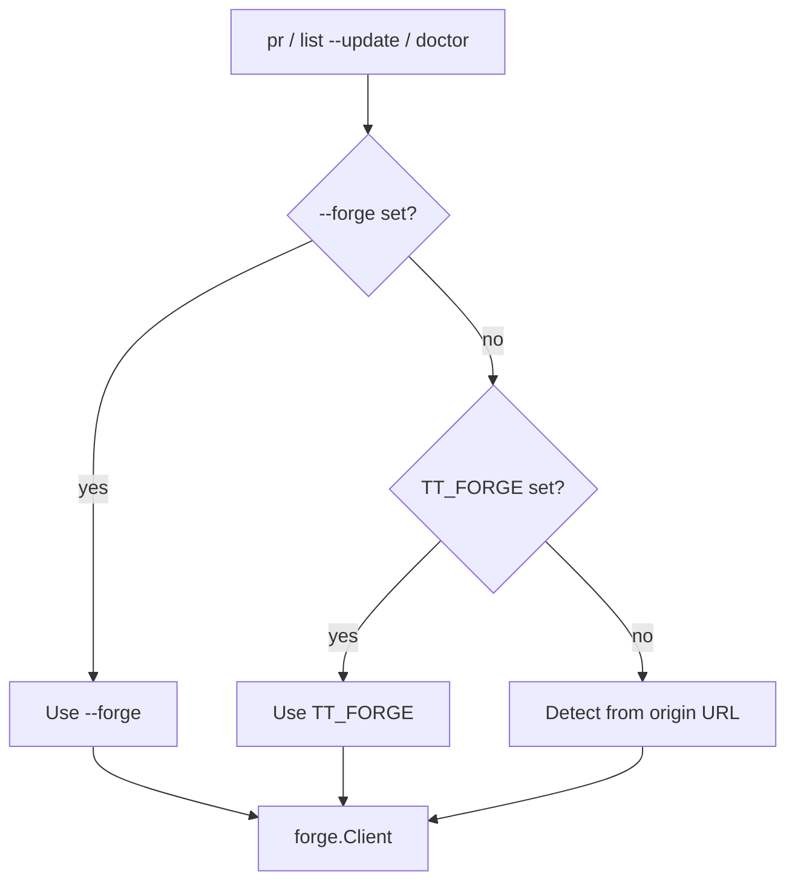

# Forge CLI フラグと Help 発見性（`--forge`）

## 背景 (Background)

[001-GitLab-MR-Support.md](file://prompts/phases/000-foundation/branches/feat-adjust-gitlab/ideas/001-GitLab-MR-Support.md) で、`tt pr` / `tt list --update` / `tt doctor` のホスト解決は次の優先順とした。

1. 環境変数 `TT_FORGE`
2. `git remote get-url origin` の自動検出
3. `unknown`（クライアント選択時は GitHub 経路へフォールバック）

この設計は動作するが、**CLI の Usage / `--help` にホスト指定手段が現れない**。フラグが無く Short 1 行だけの Help だと、人間だけでなく LLM エージェントも「GitLab をどう指定して実行するか」を `--help` から復元できない。ローカル Docker GitLab（`localhost:8929`）のように URL に `gitlab` を含まないセルフホストでは、明示指定が必須なのに発見手段が env のみ、というギャップが大きい。

本仕様は、明示指定を **CLI フラグ `--forge`** として露出させ、あわせて関連コマンドの Help にホスト解決契約を記載することを要件化する。001 の forge 抽象・`TT_FORGE`・URL 検出自体は維持し、発見性とエージェント実行性を足す。

---

## 要件 (Requirements)

### 必須要件

#### R1: `--forge` フラグでホストを明示指定できること

- 対象コマンド: `tt pr`、`tt list`、`tt doctor`
- フラグ: `--forge <host>`
  - 値: `github` | `gitlab`（大文字小文字無視）
  - 未指定: フラグによるオーバーライドなし
  - 不正値: エラー（黙殺しない）。`tt doctor` もフラグ不正値はコマンド失敗としてよい（診断継続のための unknown 緩和は **env `TT_FORGE` 不正時の既存方針に限定**し、CLI フラグ不正は Fail Fast）
- `--forge` は **永続設定を書き換えない**（そのプロセス／コマンド実行のみ）

#### R2: ホスト解決の優先順位を更新すること

確定優先順位:

1. CLI フラグ `--forge`（最優先）
2. 環境変数 `TT_FORGE`
3. `git remote get-url origin` の hostname による自動検出
4. `unknown`（クライアント選択時は GitHub 経路へフォールバック）

- `--forge` と `TT_FORGE` が両方ある場合は **`--forge` が勝つ**
- URL に `gitlab` が無いセルフホストでも `--forge gitlab` で GitLab 経路にできること（001 R4 と同等の到達性）

#### R3: `--help` / Usage から実行契約が読めること

次を各対象コマンドの Help（少なくとも `Long`、必要なら Short の補足）に含めること。

- 何をするコマンドか（PR / MR、list の update、doctor のツール診断）
- ホスト解決の優先順位（`--forge` > `TT_FORGE` > origin URL）
- `--forge` の取りうる値（`github` | `gitlab`）
- 関連 env（最低限 `TT_FORGE`、`TT_CMD_GH`、`TT_CMD_GLAB` の存在と役割の一行説明）

`tt pr --help` の出力だけを見た LLM／人間が、追加ドキュメント無しで GitLab 向け実行例を構成できること。例として Help 内または Examples に次相当を含めてよい。

```text
tt pr --forge gitlab <branch> [feature]
TT_FORGE=gitlab tt pr <branch> [feature]
```

#### R4: 既存の自動検出・env 経路を壊さないこと

- `--forge` 未指定かつ `TT_FORGE` 未設定のとき、001 どおり origin URL 検出
- `TT_FORGE` のみの既存利用はそのまま有効
- `TT_CMD_GH` / `TT_CMD_GLAB` の意味は変更しない

#### R5: ドキュメント整合

- `README.md` および `docs/manual/tt-user-manual.md` に `--forge` と更新後の優先順位を追記すること
- 001 の「`TT_FORGE` 最優先」記述がある箇所は、本仕様の優先順位に合わせて更新すること（矛盾を残さない）

### 任意要件

| 対象 | 扱い |
|---|---|
| 他サブコマンド（`open` / `merge` 等）への `--forge` | 対象外（Change Request／doctor 経路に限定） |
| シェル補完での値候補 | 望ましいが必須ではない |
| PowerShell 向け専用フラグ | 不要（`--forge` で OS 横断） |

### 対応不要（確定）

- forge パッケージの GitHub/GitLab クライアント実装のやり直し
- Docker GitLab ライブ基盤（002）の必須化
- `tt scaffold` の取得先変更

---

## 実現方針 (Implementation Approach)

### 方針概要

- **CLI 面**: cobra の `--forge` を `pr` / `list` / `doctor` に追加
- **解決面**: `internal/forge` の解決 API に「明示 host オーバーライド」（フラグ由来）を渡せるようにし、優先順位を R2 どおりに一本化
- **Help 面**: 各コマンドの `Long`（および必要なら root の関連説明）に R3 の契約を記載
- **互換**: env／URL 検出は残す。フラグは薄いアダプタ

### 優先順位（更新後）



### 主要変更ポイント（概要）

1. **`internal/forge`**: `ResolveHost` / `DetectHostFromRepo`（または同等）が「CLI 明示値」を最優先で受け取れること。不正値は既存 `ParseForgeOverride` と同様にエラー。
2. **`features/tt/cmd`**: `pr` / `list` / `doctor` に `--forge` を定義し、解決処理へ渡す。Help `Long` を R3 充足に更新。
3. **docs**: README / tt-user-manual / 必要なら 001 参照箇所の優先順位更新。

PowerShell 例（Help または manual に載せる想定）:

```powershell
tt pr --forge gitlab <branch> [feature]
```

---

## 検証シナリオ (Verification Scenarios)

1. 新しい `tt` バイナリで `tt pr --help` を実行する。出力に `--forge` と、優先順位（`--forge` > `TT_FORGE` > origin）および `github`/`gitlab` が含まれることを確認する。
2. `tt list --help` と `tt doctor --help` でも同様に `--forge` とホスト解決の説明が見えることを確認する。
3. origin が GitHub URL のリポジトリで `tt pr --forge gitlab --dry-run ...`（または同等の解決結果が観測できる手段）を実行し、GitLab 経路が選ばれることを確認する。
4. `--forge` 未指定・`TT_FORGE=gitlab` のとき、従来どおり GitLab 経路になることを確認する。
5. `--forge github` かつ `TT_FORGE=gitlab` のとき、**`--forge` が勝ち** GitHub 経路になることを確認する。
6. `--forge bogus` でエラー終了し、不正値が黙殺されないことを確認する。
7. origin が `http://localhost:8929/...`（hostname に `gitlab` 無し）でも `tt doctor --forge gitlab`（または pr/list）で GitLab 向け診断／経路になることを確認する。

---

## テスト項目 (Testing for the Requirements)

### 要件と検証の対応

| 要件 | 検証 |
| :--- | :--- |
| R1 `--forge` 追加 | 単体: フラグ解析／解決優先。統合: `tt pr|list|doctor --help` に `--forge` が出る |
| R2 優先順位 | 単体: `--forge` > `TT_FORGE` > URL のテーブル。統合: dry-run または doctor JSON で経路が分かる場合はそれを利用 |
| R3 Help 契約 | 統合: `--help` 出力に優先順位・値・関連 env が含まれることをアサート |
| R4 互換 | 単体: フラグ無し時は既存 `TT_FORGE`/URL 挙動。既存 forge テストが回帰しないこと |
| R5 docs | 変更ファイルの存在確認（文言の機械アサートは任意）。Help 統合を主証拠とする |

### ビルド・全体検証

1. ビルド＋単体テスト:
   `scripts/process/build.sh`

2. tt 統合（Help / forge 指定の発見性・解決）:
   `scripts/process/integration_test.sh --categories tt --specify "Forge|PR|Doctor|List|Help"`

   （実装計画でテスト名が確定したら `--specify` を具体名に更新すること。少なくとも `tt pr --help` / `tt doctor --help` を機械検証するケースを含める。）

3. ライブ GitLab は本仕様の必須ではない。ただしローカル CE がある場合の任意確認:
   `TT_LIVE_GITLAB=1 ./scripts/dev/gitlab-live.sh smoke`
   （`--forge gitlab` を live 経路に載せる場合は計画側で明示。002 の必須化はしない。）
