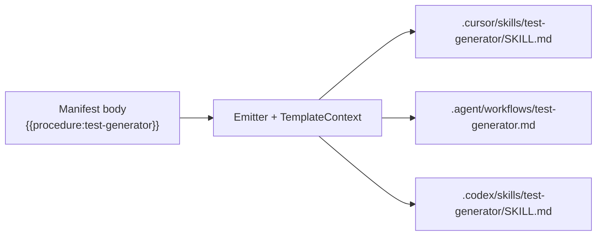

# 024: ターゲット非依存エンティティ参照 (`{{kind:id}}`) の全ターゲット解決

## 背景 (Background)

マニフェスト本文では、エージェント固有パスを書かずに他エンティティを指せるよう、テンプレート参照 `{{kind:id}}` を使える設計になっている（例: `{{policy:testing-rules}}`, `{{procedure:test-generator}}`, `{{capability:portable-file-references}}`）。

Emit 時にターゲット固有パスへ展開されることを期待して、ソースパス表記を次のように置換してみた:

> `prompts/manifest/code_content/procedures/test-generator.md` → `{{procedure:test-generator}}`

しかし `tt prompt update` 後の成果物では `{{procedure:test-generator}}`（および既存の `{{policy:...}}` 等）がそのまま残り、エージェントが読むパスとして解釈されなかった。

### 現状の実装ギャップ

| 箇所 | 現状 |
| :--- | :--- |
| `features/tt/internal/prompt/emitter/template.go` | `policy` / `procedure` / `capability` / `target` の解決ロジックは存在する |
| `antigravity.go` | `ResolveTemplateVars` を policy / capability / procedure の body に適用している |
| `cursor.go` / `codex.go` / `claude_code.go` | **`ResolveTemplateVars` を呼んでいない**（本文に `{{...}}` が残る） |
| `resolvePolicyPath` | Antigravity 前提（拡張子 `.md`、`project-instructions` → `instructions.md`）。Cursor の実ファイルは `.mdc` かつ rename なし |

実例:

- Antigravity 成果物では `{{policy:coding-rules}}` → `.agent/rules/coding-rules.md` に解決済み
- Cursor 成果物（例: `.cursor/skills/test-generator/SKILL.md`）では `{{policy:testing-rules}}` が未解決のまま残存

ドキュメント側も `prompt-manifest-update` が「policy 間参照」のみ言及しており、procedure / capability の利用が公式に揃っていない。

加えて、`{{kind:id}}` テンプレートの使い方は CLI ヘルプからは辿れない。`tt --help` / `tt prompt` でマニュアル表示コマンドへ誘導し、仕様そのものを CLI から出力できるようにする必要がある。

## 要件 (Requirements)

### 必須要件

#### R1: 全ターゲット emitter で本文の `{{kind:id}}` を解決する

次の emitter すべてで、policy / capability / procedure の body を書き出す直前に `ResolveTemplateVars` を適用すること。

- Antigravity（既存・維持）
- Cursor
- Codex
- Claude Code

適用タイミングは frontmatter 除去・改行正規化の後、ターゲット固有 frontmatter 組み立ておよびファイル書き込みの前とする。capability の `RewriteBundlePaths` がある場合は、テンプレート解決の後にパス書き換えを行う（既存計画 `024-Capability-Skill-Bundle` と整合）。

#### R2: デプロイ対象の全 kind を参照解決の対象とする

本文中で使える参照 kind と解決先の対応:

| kind | 解決先の意味 | 備考 |
| :--- | :--- | :--- |
| `policy` | 当該ターゲットの rules 配下のポリシーファイル | 拡張子・ファイル名は R3 |
| `procedure` | 当該ターゲットの procedure 出力パス | workflows があれば `{workflows}/{id}.md`、なければ `{skills}/{id}/SKILL.md`（現行ロジック） |
| `capability` | `{skills}/{id}/SKILL.md` | |
| `target` | `name` / `meta_dir` 等の既存特殊変数 | 現状維持 |

「procedure の他も全て」の意図は、上記のデプロイ対象 kind を漏れなく同じ仕組みで解決すること。`skip` / `bundle` / `guard` / `worker` など **成果物パスを持たない kind** は参照解決の対象外とし、未知 kind は現行どおり置換せず残す。

`memory` kind は過去に削除済みであり、再導入しない。

#### R3: 解決パスを各ターゲットの実レイアウトに一致させる

`TemplateContext`（または同等）がターゲットごとの出力規約を持ち、解決結果が実際の emit ファイルパスと一致すること。

少なくとも次を満たす:

| ターゲット | policy の例 (`coding-rules`) | `project-instructions` | procedure の例 (`test-generator`) |
| :--- | :--- | :--- | :--- |
| Cursor | `.cursor/rules/coding-rules.mdc` | `.cursor/rules/project-instructions.mdc`（rename なし） | `.cursor/skills/test-generator/SKILL.md` |
| Claude Code | `.claude/rules/coding-rules.md` | `.claude/rules/project-instructions.md` | `.claude/skills/test-generator/SKILL.md` |
| Codex | `.codex/rules/coding-rules.md` | `.codex/rules/project-instructions.md` | `.codex/skills/test-generator/SKILL.md` |
| Antigravity | `.agent/rules/coding-rules.md` | `.agent/rules/instructions.md`（rename あり） | `.agent/workflows/test-generator.md`（workflows 使用時） |

rules / skills / workflows のベースパスは各 target YAML の `paths` を用いる（現行どおり上書き可能）。

#### R4: カタログ・作業用マニフェストで procedure / capability 参照を使えることを保証する

ソース本文に `{{procedure:id}}` / `{{capability:id}}` / `{{policy:id}}` を書いた場合、`tt prompt update --target <各ターゲット>` 後の成果物ではリテラル `{{...}}` が残らず、R3 のパスに置換されていること。

本仕様の範囲では、既存ソース内のハードコードパスを一括置換すること自体は必須としない（利用可能にすることが主目的）。ただし検証用に少なくとも 1 箇所の `{{procedure:...}}` 参照が解決されることを確認する。

#### R5: ドキュメントを更新する

`prompt-manifest-update`（カタログ原本および作業ツリー）の「policy 間参照」記述を拡張し、`{{policy:id}}` / `{{procedure:id}}` / `{{capability:id}}` / `{{target:...}}` がターゲット非依存参照であり、emit 時に各エージェントパスへ展開されることを明記する。

#### R6: `tt` / `tt prompt` ヘルプにテンプレートマニュアルへの案内を加える

`tt --help` および `tt prompt`（親コマンド）の説明文に、テンプレート参照仕様のマニュアルを表示する手段への案内を含めること。

現状（抜粋）:

```
prompt              Manage prompt manifest compilation and deployment
```

期待する方向性:

- `tt --help` の Available Commands における `prompt` の Short（または同等の一行説明）に、マニュアル表示への誘導が含まれる
- `tt prompt` / `tt prompt --help` の Long（またはコマンド一覧の前後）に、`tt prompt instruction` でテンプレート仕様を表示できる旨が明記される

文言は実装時に調整してよいが、次の情報は必ず含める:

1. マニフェスト本文で `{{kind:id}}` 形式のターゲット非依存参照が使えること
2. 詳細は `tt prompt instruction` で確認できること

#### R7: `tt prompt instruction` サブコマンドを追加し、テンプレート仕様を出力する

`tt prompt` 配下に新しいサブコマンド `instruction` を追加する。

| 項目 | 内容 |
| :--- | :--- |
| コマンド | `tt prompt instruction` |
| 役割 | `{{kind:id}}` テンプレート参照の仕様マニュアルを標準出力へ出力する |
| 終了コード | 成功時 0 |

出力内容に少なくとも含めること:

1. 書式: `{{kind:id}}`
2. 対応 kind と解決先の意味（R2 の表と同等: `policy` / `procedure` / `capability` / `target`）
3. emit 時にターゲット固有パスへ展開されること（compile 時ではないこと）
4. ターゲット別の解決例（R3 の表と同等の要点。Cursor の `.mdc`、Antigravity の `instructions.md` / workflows など）
5. 未知 kind は置換せず残ること
6. 対象外 kind（`skip` 等）と `memory` を再導入しないことへの短い注意

実装上の制約:

- マニュアル本文はコード内定数または専用ファイルいずれでもよいが、**R2/R3 の仕様と乖離しない単一の説明源**にすること（ヘルプ Short/Long の案内文と矛盾しないこと）
- `instruction` はネットワークやワークスペース書き込みを行わない（読み取り・表示のみ）
- `--target` 等の path/compile 系フラグは不要（マニュアル表示専用）。将来ターゲット別例を絞るオプションを足す場合は任意要件とする

### 任意要件

#### O1: 未解決参照の検知（warn）

既知 kind なのにパスコンテキスト不足で空文字になる、あるいは置換されなかった `{{kind:id}}` を verbose / dry-run 時に警告する。必須ではないが、再発防止に有用。

#### O2: 共通ヘルパーへの集約

各 emitter が個別に `TemplateContext` を組み立てる重複を避け、`resolveTargetPaths` 相当を共通化する。可読性向上のためのリファクタであり、挙動変更を伴わない範囲で行う。

#### O3: `instruction` のターゲット別例フィルタ

`tt prompt instruction --target cursor` のように、特定ターゲットの解決例だけを詳しく出すオプション。必須ではない。

## 実現方針 (Implementation Approach)

### コンポーネント

1. **`template.go`**
   - `TargetPaths` または `TemplateContext` に policy ファイル命名規約（拡張子、`project-instructions` の rename 有無）を持たせる。
   - `resolvePolicyPath` / `resolveRef` をターゲット非依存の規約テーブルに基づく実装へ更新する。
2. **各 emitter (`cursor.go` / `codex.go` / `claude_code.go` / `antigravity.go`)**
   - Emit 開始時に当該ターゲット用 `TemplateContext` を構築。
   - policy / capability / procedure の body 処理パイプラインに `ResolveTemplateVars` を挿入。
3. **CLI (`features/tt/cmd/prompt.go` および関連)**
   - `promptCmd` の Short / Long を更新し、`tt prompt instruction` への案内を入れる（R6）。
   - `promptInstructionCmd`（`Use: instruction`）を追加し、テンプレート仕様テキストを stdout に書く（R7）。
   - `promptCmd.AddCommand(promptInstructionCmd)` で `compile` / `deploy` / `update` と並列に登録する。
4. **テスト**
   - `template_test.go`: ターゲット別の期待パス（特に Cursor の `.mdc` と AG の `instructions.md`）。
   - 各 emitter テスト: body に `{{policy:...}}` / `{{procedure:...}}` / `{{capability:...}}` を含むフィクスチャで、成果物に解決済みパスが含まれること・リテラルが残らないことを検証。
   - CLI テスト: `tt prompt --help` / `tt prompt instruction` の出力に必須キーワード（`{{kind:id}}`, `policy`, `procedure`, `capability`, 案内文）が含まれること。
5. **ドキュメント**
   - `capabilities/prompt-manifest-update.md`（catalog + prompts）を更新。
   - CLI マニュアル本文は R7 の説明源と内容を揃える。

### 設計上の決定

- 解決は **compile 時ではなく emit 時** に行う（現行設計を維持。ターゲットパスは emit コンテキストでのみ確定するため）。
- 未知 kind / 未知 `target:` サブキーは置換せず残す（破壊的変更を避ける）。
- procedure の workflows vs skills 分岐は既存 `resolveRef` ロジックを維持し、コンテキストの `Paths.Workflows` の有無で切り替える。



## 検証シナリオ (Verification Scenarios)

1. マニフェスト本文（例: いずれかの procedure / capability / policy）に次を含める:
   - `{{procedure:test-generator}}`
   - `{{policy:testing-rules}}`
   - `{{capability:portable-file-references}}`
2. `tt prompt update --target cursor` を実行する。
3. 当該成果物を開き、上記 3 参照がそれぞれ次に置換されていることを確認する:
   - `.cursor/skills/test-generator/SKILL.md`
   - `.cursor/rules/testing-rules.mdc`
   - `.cursor/skills/portable-file-references/SKILL.md`
   - リテラル `{{procedure:test-generator}}` 等が残っていないこと。
4. 同様に `--target ag` を実行し、少なくとも次を確認する:
   - `{{procedure:test-generator}}` → `.agent/workflows/test-generator.md`
   - `{{policy:testing-rules}}` → `.agent/rules/testing-rules.md`
   - `{{policy:project-instructions}}` を使う場合 → `.agent/rules/instructions.md`
5. `--target codex` および `--target claude-code` でも、各 `paths.rules` / `paths.skills` に沿った拡張子 `.md` のパスへ解決されることを確認する。
6. 解決対象外の表記（例: `{{unknown:foo}}`）は置換されず残ることを確認する。
7. `tt --help` を実行し、`prompt` の説明にテンプレートマニュアル（`instruction`）への案内が含まれることを確認する。
8. `tt prompt` および `tt prompt --help` を実行し、Available Commands に `instruction` が表示され、親ヘルプ本文にも案内があることを確認する。
9. `tt prompt instruction` を実行し、標準出力に R7 で列挙した項目（書式、対応 kind、ターゲット別例、未知 kind の扱い）が含まれることを確認する。書き込みやネットワークが発生しないこと。

## テスト項目 (Testing for the Requirements)

### 要件と検証の対応

| 要件 | 検証方法 |
| :--- | :--- |
| R1 | 各 emitter の単体テストで body 内テンプレートが解決されること |
| R2 | `TestResolveTemplateVars` で policy / procedure / capability / target をカバー |
| R3 | ターゲット別コンテキストでの期待パス（`.mdc` / `instructions.md` / workflows）を単体テスト |
| R4 | emitter フィクスチャに `{{procedure:...}}` を含め、成果物にリテラルが残らないこと |
| R5 | ドキュメント更新の存在確認（レビュー）＋必要なら文字列アサーションは任意 |
| R6 | `go test` またはコマンド実行テストで `tt --help` / `tt prompt --help` 出力に案内文と `instruction` が一覧されること |
| R7 | `tt prompt instruction` の stdout に必須セクション（kind 一覧・解決例）が含まれる単体/CLI テスト |

### ビルド・全体検証

1. ビルド＋単体テスト（emitter / template / cmd を含む）:

   ```
   scripts/process/build.sh
   ```

2. prompt emitter / CLI 関連の絞り込み確認（開発中）:

   ```
   go test ./features/tt/internal/prompt/emitter/... ./features/tt/cmd/... -count=1
   ```

3. 手動スモーク（任意だが検証シナリオ 7–9 と対応）:

   ```
   tt --help
   tt prompt --help
   tt prompt instruction
   ```

4. 統合テストは本変更の主影響外のため必須カテゴリは設けない。リグレッションが疑われる場合のみ:

   ```
   scripts/process/integration_test.sh --categories "common" --specify "Prompt|Manifest|tt"
   ```

   （該当テストが存在しない場合はスキップ可。本体検証は 1・2 を正とする。）
)
