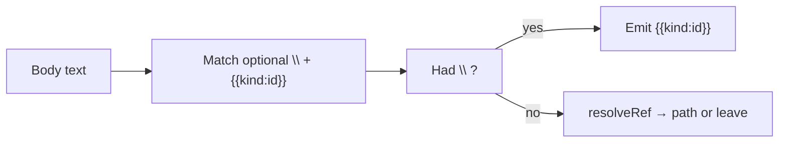

# 025: テンプレート参照のバックスラッシュ・エスケープ (`\{{kind:id}}`)

## 背景 (Background)

マニフェスト本文の `{{kind:id}}` は emit 時にターゲット固有パスへ解決される（仕様 024 / 計画 025）。

一方、`prompt-manifest-update` のような **テンプレート記法そのものを説明する文書** では、実在する kind/id の例（例: `{{policy:coding-rules}}`）をリテラルとして残したい。現状では説明用の例もパスへ置換され、記法の説明が壊れる。

三重波括弧 `{{{kind:id}}}` も候補だったが、Mustache の「非エスケープ展開」と意味が異なり分かりにくい。一般的なエスケープ直感に合わせ、**直前のバックスラッシュ**でリテラル化する。

## 要件 (Requirements)

### 必須要件

#### R1: `\{{kind:id}}` をリテラル `{{kind:id}}` に変換する

emit 時のテンプレート解決（`ResolveTemplateVars`）において、バックスラッシュでエスケープされた参照は **パスへ解決せず**、出力では先頭の `\` を取り除いた `{{kind:id}}` を残すこと。

| ソース本文 | 出力（例: Cursor） |
| :--- | :--- |
| `{{policy:coding-rules}}` | `.cursor/rules/coding-rules.mdc`（従来どおり解決） |
| `\{{policy:coding-rules}}` | `{{policy:coding-rules}}`（リテラル） |
| `\{{unknown:foo}}` | `{{unknown:foo}}`（未知 kind でも `\` は剥がす） |

エスケープ対象の `kind` / `id` の字形は、既存の解決対象パターンと同一とする（`kind` = `\w+`、`id` = `[\w][\w-]*`）。

#### R2: 処理順 — エスケープを解決より先に確定する

ナイーブな「先に `\` を削除してから解決」は禁止。そうすると `\{{policy:x}}` が一度 `{{policy:x}}` になり、直後の解決でパスに化ける。

次のいずれか（または同等）で実装すること:

1. **単一パス**: `\{{...}}` と `{{...}}` を区別してマッチし、前者はリテラル、後者は解決する
2. **プレースホルダ方式**: エスケープ済み参照を解決正規表現に引っかからない一時トークンへ置換 → 通常解決 → トークンを `{{kind:id}}` へ戻す

#### R3: 二重バックスラッシュの意味

ソースに `\\{{kind:id}}`（バックスラッシュ2つ + 参照）がある場合:

1. エスケープとして消費されるのは **参照直前の1つの `\` のみではない**
2. 定義: 参照の直前に `\` が **1つだけ**付いているときのみエスケープとみなす
3. `\\{{policy:coding-rules}}` は「リテラルの `\` 1つ」+「通常の解決対象 `{{policy:coding-rules}}`」とし、Cursor では `\.cursor/rules/coding-rules.mdc` となること

（実装上は「エスケープマッチを参照直前の単一 `\` に限定」すれば自然に満たせる。）

#### R4: 既存の非エスケープ解決挙動を維持する

エスケープなしの `{{policy|procedure|capability|target:...}}` の解決結果、未知 kind の非置換、`ctx == nil` 時の通し、は現行どおり変えないこと。

#### R5: マニュアルとドキュメントを更新する

1. `TemplateRefManual()`（`tt prompt instruction`）にエスケープ構文の節を追加する。少なくとも次を含める:
   - 書式: `\{{kind:id}}`
   - 意味: emit 後も `{{kind:id}}` がリテラルとして残る（ドキュメント用）
   - 通常の `{{kind:id}}` との対比表または同等の説明
2. カタログ原本 `prompt-manifest-update`（および作業ツリーに存在すれば同ファイル）のエンティティ参照説明で、**実在 kind の例示**は `\{{...}}` で書くか、エスケープの存在を明記する。説明の意図が emit 後も残ること。

#### R6: 回帰テスト

単体テストで少なくとも次をカバーする:

- `\{{policy:coding-rules}}` → `{{policy:coding-rules}}`
- 同一文字列内にエスケープと通常参照が混在しても、それぞれ正しく処理される
- `\\{{policy:coding-rules}}` → `\` + 解決済みパス（R3）
- エスケープなしの既存ケースが壊れていないこと
- `TemplateRefManual` に `\{{` または "escape" / エスケープ説明が含まれること

統合（CLI emit）でも、本文に `\{{policy:coding-rules}}` を含むフィクスチャを `tt prompt update` し、成果物にリテラル `{{policy:coding-rules}}` が残り、誤ってパス置換されていないことを確認する。

### 任意要件

#### O1: 連続エスケープの追加ドキュメント例

マニュアルに `\\{{...}}` の一行例を載せる（R3 の理解補助）。必須ではないが推奨。

## 実現方針 (Implementation Approach)

### コンポーネント

1. **`features/tt/internal/prompt/emitter/template.go`**
   - `ResolveTemplateVars` を R1–R3 に合わせて更新。
   - 推奨実装（単一パス）:
     ```go
     // Matches optional single backslash escape before {{kind:id}}
     var templateVarRegex = regexp.MustCompile(`(\\?)(\{\{(\w+):([\w][\w-]*)\}\})`)
     ```
     - グループ1が `\` なら `{{kind:id}}`（グループ2）をそのまま返す
     - 空なら従来どおり `resolveRef`；解決不能ならマッチ全体を返す
   - `TemplateRefManual` に Escape 節を追加する。
2. **`template_test.go` / 既存 emitter・CLI テスト**
   - エスケープ用例を追加。既存ケースは維持。
3. **ドキュメント**
   - `catalog/.../capabilities/prompt-manifest-update.md` の例示をエスケープ対応に更新。
   - prompts 作業ツリーに同 capability があれば同様に揃える。

### 設計上の決定

- エスケープは **emit 時解決の一部**であり、compile 時には触れない（024 と同様）。
- 新しい kind（`literal` 等）は導入しない。構文はバックスラッシュのみ。
- バックスラッシュが `{{` 以外に続く場合は従来どおり無関係な文字として残す。



## 検証シナリオ (Verification Scenarios)

1. 単体: `ResolveTemplateVars("Use \\{{policy:coding-rules}} in docs.", cursorCtx)` が `Use {{policy:coding-rules}} in docs.` を返す（Go 文字列では `"Use \\{{policy:coding-rules}} in docs."`）。
2. 単体: 同一入力に `\{{policy:coding-rules}}` と `{{procedure:test-generator}}` を含め、前者がリテラル、後者が `.cursor/skills/test-generator/SKILL.md` になる。
3. 単体: `\\{{policy:coding-rules}}`（ソース上バックスラッシュ2つ）が `\.cursor/rules/coding-rules.mdc` になる。
4. `tt prompt instruction` の出力に `\{{kind:id}}`（または同等のエスケープ説明）が含まれる。
5. フィクスチャ procedure 本文に `Example: \{{policy:coding-rules}}` と `Live: {{policy:coding-rules}}` を書き、`tt prompt update --target cursor` 後の成果物で前者がリテラル、後者が `.cursor/rules/coding-rules.mdc` になっている。
6. `prompt-manifest-update` を update した成果物で、記法説明の例がパスに潰れていない（エスケープ適用後）。

## テスト項目 (Testing for the Requirements)

### 要件と検証の対応

| 要件 | 検証方法 |
| :--- | :--- |
| R1 | `TestResolveTemplateVars` にエスケープケースを追加 |
| R2 | 上記がパスに化けないことで処理順を担保 |
| R3 | 二重バックスラッシュのテーブルケース |
| R4 | 既存テーブルケースを維持・全パス |
| R5 | `TestTemplateRefManual_ContainsRequiredSections` に escape 用キーワード追加。ドキュメント更新はレビュー＋必要なら文字列確認 |
| R6 | 単体 + `tests/tt` の template refs 統合テスト拡張 |

### ビルド・全体検証

1. ビルド＋単体テスト:

   ```
   scripts/process/build.sh
   ```

2. emitter / template 絞り込み:

   ```
   go test ./features/tt/internal/prompt/emitter/... ./features/tt/cmd/... -count=1
   ```

3. テンプレート参照まわりの統合テスト:

   ```
   scripts/process/integration_test.sh --categories "common" --specify "TemplateRef|Prompt"
   ```

   （該当テスト名に合わせて `--specify` を調整。新規ケースを `tests/tt/tt_prompt_template_refs_test.go` に追加する想定。）
)
