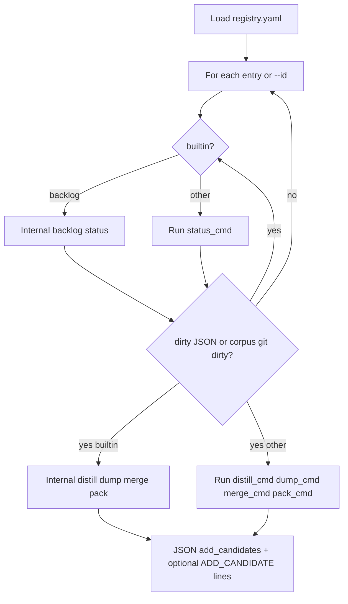

# tt への KDB 標準機能実装とエージェント向け help

## 背景 (Background)

### 依頼の経緯

`preview-legal-chkai`（ブランチ `feat-knowledge-db-git-share`）は知識DBの標準機能を
`scripts/kdb/`（横断）と `scripts/kdb-backlog/`（backlog）として持つ。
入口は bash だが、JSON 配列処理は `bl_json.py` 経由で **Python 3 必須**である。
依存削減のため、実装を配布済みの **`tt`（Go）へ移植・統合**する方針が決まった
（依頼元 backlog 014 / 015 決着）。

本依頼の範囲は次の二つを合わせたものだけである。

1. 横断操作: registry 読取と巡回（現行 `scripts/kdb/`）
2. backlog 操作: CRUD・共有パイプライン・SQLite キャッシュ（現行 `scripts/kdb-backlog/` + `bl_json.py`）

データ（registry・corpus・data・tmp）は各アプリケーションリポジトリに残す。
CLI・JSON 契約・UUID・distill→dump→merge→pack は現行どおりとし、実装言語だけ Go に置換する。

### 含めないもの（非ゴール）

- `scripts/design/`（designdb）の `tt` 内蔵化（registry `*_cmd` 委譲は行う）
- 表形式 Markdown export（依頼元仕様 006）、Box Notes API、製品 DB/GUI
- 純 bash 再実装、Python 継続
- 依頼元リポジトリのスキル全文書き換え（コマンド名確定後の追従は依頼元）
- フレームワークの再設計や、現行に無い知識種類の追加

### コマンド命名の再設計（Tokotachi 側）

依頼元案の `tt kdb` + `tt backlog` 二本立ては、backlog が「登録済み kdb の一種」であることに合わない。
また `tt kdb track` と `tt kdb backlog` を同階層に置くと、フレームワーク語と id が衝突する。

そのため本仕様では次を採用する。

| 入口 | 役割 |
| :--- | :--- |
| `tt kdb-track …` | registry の追跡・巡回（フレームワーク） |
| `tt kdb <id> …` | 登録済み知識DBへの操作。`backlog` は builtin、それ以外は `*_cmd` 委譲 |

`tt kdb call` は採用しない（id がサブコマンド位置に来るため不要）。

### エージェント向け help の不足

知識DB能力は「操作の詳細は CLI の help を読め」とスキルに書ける契約になっている。
一方、現行の `tt` 全体の help は cobra の短い Short/Long が中心で、
**AI が手順書代わりに読める Markdown マニュアル**としては不足している。
スキルに使い方を写経せず、`tt help …` を見ろと書くだけで済ませる必要がある。
本仕様では **新規 KDB コマンドに加え、既存の `tt` サブコマンド群も** 同契約へ揃える。

### 正本（挙動の参照）

| 領域 | 正本 |
| :--- | :--- |
| 横断 | `preview-legal-chkai` の `scripts/kdb/*.sh`、`features/kdb/registry.yaml` |
| backlog | 同 `scripts/kdb-backlog/*.sh`、`schema.sql`、`bl_json.py`（挙動の正。言語は Go） |
| フレームワーク文言 | 同 `prompts/manifest/code_content/capabilities/knowledge-database.md` |

---

## 要件 (Requirements)

### 必須要件

#### 共通・範囲

##### R1: 背景・範囲・非ゴールを守る

上記「背景」の範囲と非ゴールに従う。designdb の builtin 化、表 Markdown export、製品 DB/GUI は実装しない。

##### R2: コマンド木

```text
tt kdb-track list|unregistered|status-cmds|status-all|systematize [--id <kdb-id>]

tt kdb <id> <op> ...
  # builtin id=backlog の op:
  add|list|get|update|resolve|import-md
  distill|dump|merge|pack|unpack|restore|status
  migrate-uuids   # 任意の一次性ツール（日常必須ではない）

  # 非 builtin（例: designdb）:
  status|distill|dump|merge|pack
  # → registry の対応 *_cmd を委譲実行（本依頼ではスキップしない）
```

- `help` / `completion` など cobra 予約語は kdb id に使えない（使用時は用法エラー）。
- registry に無い id への操作はエラー（勝手にシェルを実行しない）。
- 機能欠落がなければ、依頼元スキル側の旧名（`tt backlog …` 案など）との差は許容する。依頼元が追従する。

---

#### 節 A. 横断標準（`tt kdb-track`）

##### R3: registry 読取

- 既定パス: `{repo}/features/kdb/registry.yaml`
- 上書き: フラグおよび環境変数 `KDB_REGISTRY`（フラグ優先）
- 必須フィールド: `version`（>=1）、各エントリの `id`, `module_path`, `corpus_path`, `status_cmd`, `distill_cmd`, `dump_cmd`, `merge_cmd`, `pack_cmd`
- 浅い YAML を解釈できればよい（現行 awk パーサ相当）。未知キーは無視してよい

##### R4: 横断コマンドの振る舞い

| コマンド | 振る舞い |
| :--- | :--- |
| `list` | 登録エントリを JSON で返す（id / パス / cmd 一覧） |
| `unregistered` | `features/*/corpus` にあって registry の `corpus_path` に無い id を JSON で返す |
| `status-cmds` | 各エントリの `status_cmd` を JSON で列挙 |
| `status-all` | 登録済み各知識の status を順に実行し、結果を集約 JSON で返す |
| `systematize` | 各エントリ（または `--id`）について status と corpus の git dirty を見て、dirty なら distill→dump→merge→pack。成功 JSON に `add_candidates`（文字列配列）。移行期は stdout に `ADD_CANDIDATE: <path>` 行も出してよい（廃止は依頼元スキル更新後） |

##### R5: builtin と委譲の切り分け（横断から見たとき）

- id `backlog`（および将来の builtin）: registry の `*_cmd` を **無視**し、`tt` 内蔵実装を呼ぶ
- それ以外（designdb 含む）: registry の `*_cmd` を **委譲**する（本依頼ではスキップしない・builtin 化しない）
- `status-all` / `systematize` で委譲が失敗したエントリは、集約 JSON にエラーを含め、当該エントリは失敗扱い。他エントリの処理方針は実装計画で具体化するが、少なくとも失敗が黙殺されないこと

---

#### 節 B. backlog 標準（`tt kdb backlog`）

##### R6: CRUD と共有パイプライン

現行 `scripts/kdb-backlog` と同等の振る舞いを Go で提供する。

| op | 役割 |
| :--- | :--- |
| `add` | 項目追加（UUID 発行。論理キー未指定時は local_id 採番） |
| `list` | 一覧・フィルタ・ソート・ページ（既定で決着/取り下げ除外、など現行どおり） |
| `get` | uuid または phase/branch/id |
| `update` | 欄更新・`--append-history`。決着/取り下げへの `--state` は拒否 |
| `resolve` | 決着 / 取り下げ |
| `import-md` | 旧 Markdown からの取込 |
| `distill` | 検証・同一重複の畳み込み |
| `dump` | SQLite → tmp `items.json` |
| `merge` | tmp と data の単純マージ → 衝突無ければ restore |
| `pack` | data → corpus（chunk + manifest、`content_hash` 安定） |
| `unpack` | corpus → data |
| `restore` | data → SQLite |
| `status` | corpus / data / DB の dirty |
| `migrate-uuids` | uuid 欠落コーパス救済用の一次性ツール（日常 CLI の必須メニューに載せなくてよいが、コマンドとして提供） |

##### R7: データ契約

- スキーマは現行 `schema.sql` 相当を内蔵（埋め込み SQL で適用）
- 永続レコードは UUID 必須。参照・突き合わせの正は UUID。論理キー（phase/branch/local_id）は局所
- state / kind の日本語リテラルは契約として固定（`未確認` / `確認中` / `決着` / `取り下げ`、`仮の決定` / `確認事項` / `先送り`）。英訳エイリアスは不要
- 退避: distill → dump(tmp) → 単純マージ(tmp, data) → pack(data→corpus)
- 再構築: unpack(corpus→data) → restore(data→DB)
- 単純マージは結合のみ。重複の是非は distill。merge 衝突時の終了コードは現行どおり（衝突ありで restore しない場合 exit 3 相当を維持）
- エージェントに生 SQL や接続文字列を扱わせない
- Python / 外部 `sqlite3` CLI は不要（Go 埋め込み SQLite のみ）

##### R8: パス解決

- **正は registry** の当該 id の `corpus_path` と、対になる data / tmp / DB
- ハードコード単独にしない。フラグおよび環境変数（現行 `BL_*` / `KDB_*` 相当）で上書き可能
- 依頼元の移設先方針は `scripts/kdb/backlog/{corpus,data}`。tt 出荷時点で未移設でも、registry が `features/backlog/...` なら動くこと
- 緑地（新規リポ）の推奨既定は `scripts/kdb/backlog`
- リポジトリルート: `--workspace`（または同等）および環境変数、未指定時は CWD。現行試験用の `BL_ROOT` / `BL_TODAY` 等は残す

##### R9: JSON / 終了コード（操作時）

- 操作成功: stdout に JSON 一つ（`ok: true` を含む現行形を踏襲）
- 失敗: stderr に JSON（`ok: false`, `error`, `help`）
- 失敗 JSON の `help` は **`tt … help` 形式**（例: `tt kdb backlog add help`）
- 終了コード番号は現行 `*.sh` / `bl_json.py` を機械的に踏襲する（用法 2、依存欠如 2、業務エラー 1、merge 衝突 3 など）

---

#### 節 C. エージェント向け help（KDB + 既存コマンド）

##### R10: help の共通契約

すべての対象コマンドについて、次を満たす help を提供する。

1. 本文は **英語**
2. 見出し順（固定）: Purpose / When to use / When not to use / Preconditions / Input and output / Exit codes / Read next
3. help は **副作用なし**（DB・ネットワーク・書き込み不要）で exit 0
4. help 成功時の stdout は **Markdown**
5. Read next には実在する help トピックだけを書く
6. 操作マニュアルの全文をスキルへ写さない前提で、スキルからは `tt help …`（または同等）を読むよう指示できる粒度であること

##### R11: 呼び出し形

次のいずれでも、同じ Markdown 本文に到達できること。

- `tt help <command-path…>`（例: `tt help kdb-track systematize`、`tt help kdb backlog add`、`tt help prompt update`）
- 各コマンドの `help` / `--help` / `-h`（KDB 系は現行スクリプトと同様に位置引数 `help` も可）

ルート `tt help`（引数なし）は、主要コマンド一覧と「詳細は `tt help <cmd>`」への案内を Markdown で出す。

##### R12: 既存コマンドへの適用

`tt` に既に存在するサブコマンド（`up` / `down` / `create` / `prompt` / `agent` / …）についても R10 の 7 見出し Markdown に揃える。
現状の短い Short/Long だけの help は、エージェント手順書としては不十分とみなす。

段階導入を認める場合でも、本仕様の完了条件には **全トップレベルコマンドおよび、エージェントが日常的に使う主要な子孫コマンド**（少なくとも `prompt` 配下、`agent` 配下、ワークツリー系）が R10 を満たすことを含める。

##### R13: KDB help と knowledge-database 契約の一致

節 A/B の各コマンド help は、依頼元 capability の help 規約および現行 `*.sh help` の情報量を下回らないこと（フラグ、終了コード、Read next）。
Preconditions から「Python / 外部 sqlite3 必須」は除去し、Go 埋め込み前提に更新する。

---

#### 受け入れ・試験

##### R14: 受け入れ条件（機能）

1. Python なしで、backlog について distill → dump → merge → pack が完了し、corpus の `content_hash` が同一入力で安定する
2. unpack → restore のあと、list の件数と各 uuid が保持される
3. add / list / get / update（append-history 含む）/ resolve が現行相当の JSON で動く
4. `tt kdb-track list` が registry を読む。`systematize` が少なくとも backlog を退避できる。designdb エントリがあるフィクスチャでは `*_cmd` 委譲が呼ばれる（スキップしない）
5. 各主要コマンドの help が DB なしで読める（R10）
6. 現行 `bl_json.py` が担っていた JSON 配列の pack/unpack/merge/フィルタ相当が Go で置換されている
7. `tt help` / `tt help <既存コマンド>` が R10 の Markdown を返す

##### R15: 受け入れ試験の置き場

- **正は Tokotachi リポジトリ側**（フィクスチャで契約試験）
- 依頼元リポジトリの実コーパスでのスモークは任意・後続（本仕様の完了条件に含めない）

##### R16: 移行の境界

旧 `scripts/kdb*` の削除または `tt` 呼び出しラッパ化は **依頼元リポジトリ側作業**として本仕様の実装完了後に行う。Tokotachi 仕様の完了条件には含めない。

---

### 任意要件

#### O1: `tt kdb-track systematize` の並列実行

エントリ数が多い場合の並列化。必須ではない。

#### O2: help のセクション一部自動生成

Exit codes / flags を cobra メタデータから生成する。本文の Purpose 等は人手（または定数）でよい。

#### O3: リポジトリルートの git 上位探索

CWD がサブディレクトリでも git ルートを見つける。未実装なら `--workspace` / 環境変数で足りる。

#### O4: knowledge-database capability の Tokotachi catalog 掲載

フレームワーク説明を Tokotachi 側 catalog に Mirror する。必須ではない（アプリリポの manifest に残してよい）。

---

## 実現方針 (Implementation Approach)

### パッケージ構成（案）

```text
features/tt/cmd/
  kdb_track.go          # tt kdb-track
  kdb.go                # tt kdb <id> …
  help_agent.go         # エージェント向け help 共通（既存コマンド改修の入口）

features/tt/internal/kdb/
  registry/             # registry.yaml 読取
  track/                # list / unregistered / status-all / systematize
  backlog/              # CRUD, distill/dump/merge/pack/…, schema embed
  delegate/             # 非 builtin の *_cmd 実行
  help/                 # 7 見出し Markdown テンプレート
```

既存の `modernc.org/sqlite` 依存を再利用する。`tt agent knowledge`（far-knowledge）とは別系統を維持する。

### 処理フロー（systematize）



### help 充実の方針

1. 共通ヘルパーで 7 見出し Markdown を組み立て、各コマンドに本文定数（または埋め込み `.md`）を紐づける
2. cobra の `SetHelpFunc` / カスタム `help` コマンドで `tt help …` を Markdown 出力に統一
3. KDB 系は依頼元 `*.sh help` を移植し、依存記述だけ更新
4. 既存コマンドは現状 Long を素材に、When to use / Preconditions / Exit codes を補完して R10 を満たす

### 設計上の決定（仮置き含む）

| 項目 | 決定 |
| :--- | :--- |
| コマンド木 | `kdb-track` + `kdb <id>`（`call` なし） |
| backlog | builtin。registry `*_cmd` 無視 |
| designdb | `*_cmd` 委譲。スキップしない |
| 横断 I/O | JSON + 7 見出し help（TSV は第一級にしない） |
| SQLite | Go 埋め込みのみ |
| 試験の正 | Tokotachi フィクスチャ |
| help 言語 | 英語（エージェント契約）。チャットは日本語のまま |

---

## 検証シナリオ (Verification Scenarios)

1. フィクスチャリポジトリに `features/kdb/registry.yaml`（backlog + ダミー designdb）と空の backlog data/tmp を置く。
2. `tt help` および `tt help kdb-track` / `tt help kdb backlog add` / `tt help prompt` を実行し、いずれも 7 見出しの英語 Markdown で exit 0、DB 不要であることを確認する。
3. `tt kdb backlog add --phase 000-foundation --branch feat-x --title T --kind 確認事項` が `ok:true` と uuid を返すことを確認する。
4. `list` / `get --uuid` / `update --append-history` / `resolve` を順に実行し、現行相当 JSON と状態遷移になることを確認する。
5. distill → dump → merge → pack を実行し、`manifest.json` の `content_hash` が再実行で安定することを確認する。
6. pack 後に DB を捨て、unpack → restore → list で件数と各 uuid が保持されることを確認する。
7. `tt kdb-track list` が registry の id を JSON で返すことを確認する。
8. backlog を dirty にしたうえで `tt kdb-track systematize`（または `--id backlog`）が退避し、JSON の `add_candidates` に corpus パスが入り、移行期は `ADD_CANDIDATE:` 行も出ることを確認する。
9. designdb の `status_cmd` を記録用スタブにし、`tt kdb-track status-all` および `tt kdb designdb status` でスタブが呼ばれることを確認する（スキップされないこと）。
10. 環境に Python / `sqlite3` CLI が無くても（テストでは PATH から除外して）上記が成功することを確認する。
11. 既存主要コマンド（少なくとも `up`, `prompt update`, `agent record`）について `tt help <…>` が R10 を満たすことを確認する。

---

## テスト項目 (Testing for the Requirements)

### 要件との対応

| 要件 | 自動化の考え方 |
| :--- | :--- |
| R2–R5 | `features/tt` 単体 + `tests/tt` で registry フィクスチャ / track JSON / 委譲スタブ |
| R6–R9 | backlog 契約試験（CRUD、round-trip、content_hash、merge 衝突、BL_* 上書き） |
| R10–R13 | help 出力に 7 見出しが含まれること、exit 0、副作用なし。既存コマンド分のテーブル駆動 |
| R14–R15 | 上記を Tokotachi 側テストとしてゲート。依頼元スモークは任意 |

### ビルド・全体検証

1. ビルド＋単体テスト:

```bash
scripts/process/build.sh
```

2. tt 統合テスト（KDB 契約・help・既存 CLI リグレッション）:

```bash
scripts/process/integration_test.sh --categories "tt" --specify "Kdb|Help|Prompt|Agent"
```

3. help / prompt 系に絞った確認（開発中の高速フィードバック）:

```bash
scripts/process/integration_test.sh --categories "tt" --specify "Help|Prompt"
```

> カテゴリ名は `tests/` 配下の実ディレクトリに合わせる（現状 `tt`）。
> オプションなしの全カテゴリ一括実行は本仕様の日常検証には用いない。

### 単体テストで必ず置くケース（指針）

- registry 不完全エントリで非 0
- backlog uuid 採番・論理キー衝突・resolve 以外での決着 state 拒否
- pack の `content_hash` 安定（`generated_at` 据え置き）
- merge 衝突で restore しない / exit 3 相当
- help が DB パスを触らない（sqlite ファイル未作成のまま成功）
- 既存コマンド help の必須見出し存在
