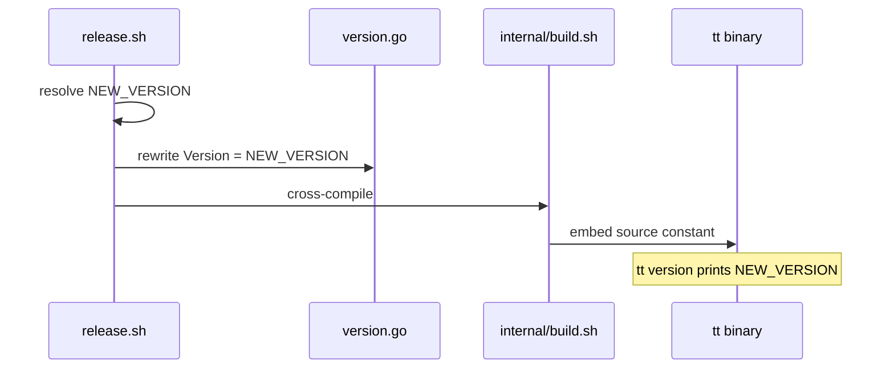

# tt 埋め込みバージョン表示とリリース時のソース書き換え

## 背景 (Background)

`tt` バイナリには実行時に参照できる製品バージョンが無い。運用・サポート・エージェント手順で
「今動いている `tt` は何版か」を確認できず、リリース成果物とローカルビルドの対応も取りにくい。

一方、ツール公開は既に `scripts/dist/tool/release.sh <tool-id> [version|+increment]` で
バージョンを決定し、Build → Release notes → Package → Publish している。
しかし `internal/build.sh` は `go build` のみで、**ソースにも `-ldflags` にもバージョンを埋め込んでいない**。

本仕様では次を行う。

1. ソースにバージョン定数（初期値 **`v0.9.1`**）を定義する
2. CLI からその値を表示できるようにする（`tt version` および `--version`）
3. リリース手順で、指定バージョンにソース定数を書き換えてから再ビルドする

`-ldflags` のみの注入は本仕様の必須とはしない（ソース正本をリリース手順で更新する方針）。

## 要件 (Requirements)

### 必須要件

#### R1: ソースにバージョン定数を置く

- `tt` のソースツリー内に、単一の正本となるバージョン文字列を定義する
- 初期値は **`v0.9.1`**（先頭の `v` を含む。既存リリースタグ `vN.N.N` と同一形式）
- 形式は `v` + SemVer の major.minor.patch（例: `v0.9.1`）。プレリリース接尾辞（`-rc.1` 等）は本仕様の必須範囲外
- 定数の置き場は実装計画で確定してよいが、**1 ファイル・1 シンボル**に集約し、CLI とリリース書き換えスクリプトの双方から辿れること

推奨例（実装時にパスを確定）:

```go
package version

// Version is the tt product version (semver with leading "v").
// Updated by the tool release procedure before rebuild.
const Version = "v0.9.1"
```

#### R2: CLI でバージョンを表示する

次をすべて満たすこと。

1. **`tt version`** サブコマンド
   - stdout にバージョンを出す（人間可読。最低限バージョン文字列。例: `tt v0.9.1` または `v0.9.1`）
   - 終了コード 0
   - ネットワーク・ワークスペース書き込みなし
2. **`tt --version` / `tt -V`**（cobra の標準 Version 機構で可）
   - ルートと同じ埋め込み定数を参照する
3. **`tt help` / `tt help version`**
   - 既存のエージェント向け help 契約（英語・7 見出し）に `version` を登録する
4. ルート help または Short から、バージョン確認手段（`tt version`）へ辿れること

成功時の出力は **プレーンテキストでよい**（JSON 必須ではない）。失敗時も通常は発生しないが、用法エラーがあれば既存 CLI 慣習に従う。

#### R3: リリース手順でソースを書き換えてからビルドする

`scripts/dist/tool/release.sh`（および必要なら `internal/build.sh`）の流れを次のようにする。

1. 従来どおり `NEW_VERSION`（例: `v0.9.1`）を決定・検証する
2. **Build の前に**、R1 のソース定数を `NEW_VERSION` に書き換える
3. そのソースでクロスコンパイル（既存の `internal/build.sh`）を実行する
4. 以降の Release notes / Package / Publish は現行どおり `NEW_VERSION` を使う

制約:

- 書き換え対象は R1 の正本ファイルのみ（無関係な `version:` YAML 等を壊さない）
- 書き換え後のファイル内容を検証し、定数値が `NEW_VERSION` と一致することを確認してからビルドする
- ローカル開発の `scripts/process/build.sh` は、リポジトリ上の定数値をそのまま埋め込む（追加引数は必須にしない）

#### R4: リリース後のソース状態

リリースパイプライン実行後、ワーキングツリー上のバージョン定数は **`NEW_VERSION` に更新されたまま**残ることを想定する。

- 公開手順の一部として、この変更を **git commit してからタグ／Publish する**か、Publish 後に commit するかは実装計画で現行 `publish.sh` のタグ作成タイミングに合わせて決める
- いずれにせよ「GitHub Release のタグバージョン」と「そのタグに含まれるソース定数」および「そのタグからビルドしたバイナリの `tt version`」が一致すること

#### R5: 非ゴール

- 他ツール（`release-note` 等）への同様埋め込みの一括展開（必要なら別仕様）
- プレリリース／ビルドメタ（git commit hash, dirty）の必須表示（任意要件可）
- Go module の `go.mod` バージョンや catalog 版との自動同期（本仕様の必須外）

### 任意要件

#### O1: ビルドメタの併記

`tt version` に `commit` / `date` を `-ldflags` で足す。ソース定数の `Version` はなお正本とする。

#### O2: JSON 出力

`tt version --json` で `{"ok":true,"version":"v0.9.1"}` を返す。

## 実現方針 (Implementation Approach)

### コンポーネント

1. **`features/tt/internal/version`（または同等）**
   - `Version` 定数
2. **`features/tt/cmd`**
   - `rootCmd.Version = version.Version`（`--version`）
   - `version` サブコマンド
   - `clihelp.Register("version", …)`
3. **`scripts/dist/tool/release.sh` / 共有ヘルパ**
   - `NEW_VERSION` 決定後、定数ファイルを sed/awk/Go 小さな更新ツール等で置換
   - 置換検証 → `internal/build.sh` 呼び出し
4. **試験**
   - 単体: 定数が空でない、形式が `v`+digits
   - CLI: `tt version` / `tt --version` が定数と一致
   - リリースヘルパ: 一時ファイルまたはフィクスチャで書き換え関数を検証（実際の GitHub Publish は必須としない）

### 設計上の決定

| 項目 | 決定 |
| :--- | :--- |
| 初期バージョン | `v0.9.1` |
| 正本 | ソース定数（ldflags のみに依存しない） |
| 表示入口 | `tt version` + `tt --version` |
| リリース | 定数書き換え → ビルド → 既存 package/publish |



## 検証シナリオ (Verification Scenarios)

1. ソース定数が `v0.9.1` の状態で `scripts/process/build.sh --backend-only`（または tt ビルド）を実行する。
2. `bin/tt version` および `bin/tt --version` が `v0.9.1` を含む出力を返し、exit 0 であることを確認する。
3. `bin/tt help version` がエージェント向け 7 見出し Markdown を返すことを確認する。
4. リリース用の書き換え手順（または単体試験）で定数を `v0.9.2` に更新し、再ビルド後に `tt version` が `v0.9.2` になることを確認する。
5. 書き換え対象外のファイル（例: `packaging/goreleaser/*.yaml` の `version: 2`）が誤って変更されていないことを確認する。
6. （統合）`release.sh` の Build 手前ステップを、Publish をスキップできる形、またはヘルパ関数の試験で「決定バージョン → ソース更新 → ビルド成果物の version 一致」を確認する。

## テスト項目 (Testing for the Requirements)

| 要件 | 自動化 |
| :--- | :--- |
| R1 | 単体で `version.Version == "v0.9.1"`（初期）および形式チェック |
| R2 | `tests/tt` で `tt version` / `tt --version` / `tt help version` |
| R3–R4 | 書き換えヘルパの単体試験 + ビルド後バイナリの version 一致（フィクスチャまたは一時モジュール） |

### ビルド・全体検証

1. ビルド＋単体テスト:

```bash
scripts/process/build.sh
```

2. tt 統合テスト（version 表示）:

```bash
scripts/process/integration_test.sh --categories "tt" --specify "Version|AgentHelp"
```

3. （開発中）version のみ:

```bash
scripts/process/integration_test.sh --categories "tt" --specify "Version"
```
