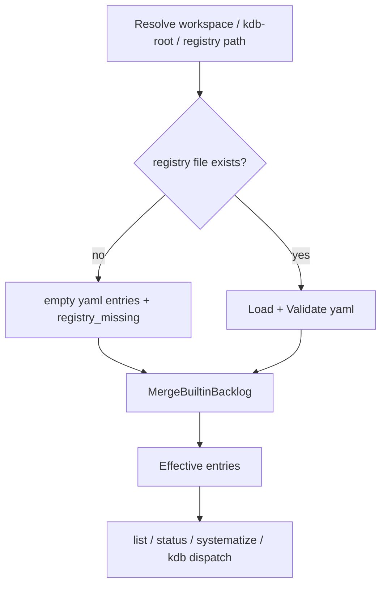

# KDB registry の shared 既定と欠落下の正常終了・組み込み backlog

## 背景 (Background)

`tt kdb-track list` は既定で `features/kdb/registry.yaml` を読む。当該ファイルが無いと
終了コード 1 の JSON エラーになり、エージェントや人が「知識DBが何か」を確認する入口が
止まってしまう。

一方、backlog は `tt` に内蔵済みであり、registry の有無に関係なく常に使えるべきである。
また、標準の置き場を `features/kdb/` にすると製品 feature と知識DBメタが混ざる。
共有の知識DB置き場として `shared/kdb/` を既定にしたい。

現状の課題:

1. registry.yaml 欠落時に list 等が失敗する
2. backlog を使うために yaml エントリが必須に見える
3. 既定パスが `features/kdb/` である
4. 空の registry を手で書くとき、スケルトンを出す手段が無い
5. yaml の `*_cmd` に引数を含めてよいことが仕様として明示されていない

関連: [026-Tt-Kdb-Std-And-Agent-Help.md](026-Tt-Kdb-Std-And-Agent-Help.md)

---

## 要件 (Requirements)

### 必須要件

#### R1: registry.yaml 欠落時はエラーにしない

- `tt kdb-track list` / `unregistered` / `status-cmds` / `status-all` / `systematize` および
  registry を前提とする横断操作で、registry ファイルが**存在しない**とき:
  - 終了コード **0**
  - `ok: true`
  - yaml 由来のエントリは **0 件**として扱う
- 応答 JSON に、ファイルが存在しない旨を明示するフィールドを含めること。
  例（名前は実現方針に従う）:
  - `registry_missing: true`
  - `registry: "<解決済みパス>"`
  - 必要なら `warning` または `message` に人間可読な一文
- ファイルは存在するが YAML 不正・必須フィールド欠落・version 不正のときは、従来どおり失敗してよい
  （欠落だけを「空」扱いする）。

#### R2: backlog は registry の有無に関係なく常に登録済み

- id `backlog` は **組み込み既定エントリ**として、常に有効な登録集合に含まれる。
- registry.yaml が無いときも、`tt kdb-track list` の `entries` には backlog が 1 件含まれる
  （「yaml 0 件」でも、表示上の登録集合は backlog を含む）。
- registry.yaml に `id: backlog` のエントリがある場合は、**yaml の内容を優先**する
  （module_path / corpus_path / *_cmd を上書き）。
- yaml に backlog が無い場合は、組み込み既定を使う。
- `tt kdb backlog …` および `tt kdb backlog` 経由のパイプラインは、yaml 欠落でも動作すること。

#### R3: 標準フォルダを `shared/kdb/` にする

- 既定の registry パス: `{workspace}/shared/kdb/registry.yaml`
- 組み込み backlog の既定:
  - `module_path`: `shared/kdb/backlog`
  - `corpus_path`: `shared/kdb/backlog/corpus`
  - data / sqlite は既存の解決規則どおり（corpus の親の `data/` など）
- ドキュメント・help・capability 文言の既定パス表記を `features/kdb/` から `shared/kdb/` へ更新する
  （本変更の対象範囲内の `tt` help と knowledge-database 能力説明）。

#### R4: KDB ルート（および registry）をオプション／環境変数で変更できる

優先順位（高い順）:

| 対象 | フラグ | 環境変数 | 既定 |
| :--- | :--- | :--- | :--- |
| workspace | `--workspace` | `TT_WORKSPACE` / `BL_ROOT` | cwd（現行どおり） |
| KDB ルート | `--kdb-root` | `KDB_ROOT` | `shared/kdb`（workspace 相対） |
| registry ファイル | `--registry` | `KDB_REGISTRY` | `{kdb-root}/registry.yaml` |

- `--registry` / `KDB_REGISTRY` が絶対・相対パスでファイルを指すときは、それをそのまま使う
  （従来どおり。KDB ルートから導出しない）。
- `--kdb-root` / `KDB_ROOT` は、registry 未指定時の既定パスと、組み込み backlog の
  module/corpus 既定（`{kdb-root}/backlog` / `{kdb-root}/backlog/corpus`）に効く。
- 相対パスは workspace 基準。

#### R5: registry スケルトンを出すサブコマンド

- `tt kdb-track skeleton` を追加する。
- 目的: エージェント／人が、空の `shared/kdb/registry.yaml` を書き始めるための雛形を得る。
- 既定動作: **標準出力へ YAML 本文を出す**（終了コード 0）。DB や既存ファイルの有無に依存しない。
- 雛形には少なくとも次を含める:
  - `version: 1`
  - `kdbs:` 配列
  - コメントまたは例として、外部 KDB（builtin 以外）のエントリ例
    （`id` / `module_path` / `corpus_path` / `status_cmd` … `pack_cmd`）
  - backlog は組み込みのため、雛形では **必須としては載せない**。
    上書き例としてコメントアウトされた backlog エントリを載せてもよい。
- `--write`（任意フラグ）: 解決済み registry パスへ雛形を書き出す。
  - 既にファイルがあるときは上書きせず失敗（exit != 0、既存保護）。
  - 親ディレクトリが無ければ作成してよい。
- help: `tt help kdb-track skeleton`（英語・固定見出し）。DB 無しで読める。

#### R6: yaml のコマンドライン指定は引数を含めてよい

- `status_cmd` / `distill_cmd` / `dump_cmd` / `merge_cmd` / `pack_cmd` は、
  **実行ファイル名だけでなく引数・フラグを含むコマンドライン文字列**として解釈する。
- 現行どおり `bash -lc` で実行してよい（スペース区切りの引数・クォートはシェル規約）。
- 例として有効であること:
  - `status_cmd: "./scripts/design/status.sh --verbose"`
  - `dump_cmd: "tt kdb other dump --prefer tmp"`
- Validate は「空でない文字列」を要求し、トークン分割や実行可能性は Validate 時点では見ない
  （実行時に delegate が失敗すればその操作が失敗する）。
- help / skeleton の例に、引数付きコマンドラインを少なくとも 1 つ含める。

#### R7: unregistered の走査先

- `tt kdb-track unregistered` は、既定で `{kdb-root}/*/corpus` を走査し、
  登録済み `corpus_path` に無い id を返す。
- 後方互換のため、`features/*/corpus` も走査してよいが、その場合は結果 JSON で
  どちら由来か分かるようにするか、help に走査ルールを明記する。
- 推奨: 主走査は `{kdb-root}`。`features/*/corpus` は deprecated として残すか、
  本仕様では kdb-root のみに寄せる（実現方針で一方に決める）。

#### R8: list 応答に `source` を付ける

- `tt kdb-track list` の各 entry に `source` を付ける。
  - `"builtin"`: 組み込み既定から採用したエントリ（yaml に同 id が無い）
  - `"registry"`: registry.yaml から採用したエントリ（backlog の yaml 上書きを含む）
- yaml で backlog を上書きした場合、その backlog の `source` は `"registry"` とする。
- `source` は list の応答用メタデータであり、registry.yaml の必須フィールドにはしない。

#### R9: テスト・回帰

- registry 欠落 / 組み込み backlog / kdb-root 上書き / skeleton / 引数付き `*_cmd` /
  `source` 付与を自動化テストで担保する（下記「テスト項目」）。

### 任意要件

#### O1: skeleton に `--stdout` 明示フラグ

既定が stdout のとき、対称性のためのエイリアス。必須ではない。

---

## 実現方針 (Implementation Approach)

### 概要



### コンポーネント

1. **`internal/kdb/paths`**
   - `RegistryPath` の既定を `{workspace}/{kdb-root}/registry.yaml` に変更。
   - `KdbRoot` 解決（flag / `KDB_ROOT` / `shared/kdb`）を追加。
   - 組み込み backlog 用の既定 `Entry` を返すヘルパ（module/corpus を kdb-root から組み立て）。

2. **`internal/kdb/registry`**
   - `Load` の呼び出し側で `os.IsNotExist` を「空 File + missing」に変換する
     （`Load` 自体は I/O エラーを返してよい。track/cmd 層で欠落を吸収）。
   - または `LoadOptional` を追加し、欠落時は `(*File, missing=true, err=nil)`。

3. **`internal/kdb/track`（または cmd 層）**
   - `EffectiveEntries(file, kdbRoot)`:
     - yaml に backlog があればそれを採用（`source: registry`）。
     - 無ければ builtin 既定を先頭または安定した位置に挿入（`source: builtin`）。
     - yaml 由来の他 id はすべて `source: registry`。
   - list 用に `Entry` を拡張するか、応答専用の `ListedEntry`（`Entry` + `source`）を返す。
   - `List` 等の JSON に `registry_missing` / `registry` を載せる。
   - `Unregistered` の走査ルートを kdb-root に変更（本仕様では **kdb-root のみ** とする）。

4. **`cmd`**
   - `tt kdb-track` に永続フラグ `--kdb-root` を追加。
   - サブコマンド `skeleton`（`--write`）を追加し、`clihelp` 登録。
   - 欠落時のエラー JSON を出していた箇所を、成功 JSON に差し替え。

5. **builtin backlog**
   - registry 無しでも `paths.ForEntry` が `shared/kdb/backlog` 系に解決されること。
   - 既存の `BL_*` 上書きは維持。

6. **ドキュメント**
   - `tt help kdb-track` / `tt help kdb` / capability `knowledge-database` の既定パス表記を更新。
   - 「`*_cmd` は引数を含むコマンドライン」を help に明記。

### 設計上の決定

| 項目 | 決定 |
| :--- | :--- |
| yaml 欠落時の list | exit 0。`entries` は builtin backlog のみ。`registry_missing: true` |
| 「0 件」の意味 | **yaml 由来が 0 件**。登録集合からは backlog を除かない |
| yaml と builtin の優先 | 同 id は yaml 優先 |
| unregistered 走査 | `{kdb-root}/*/corpus` のみ（`features/*/corpus` は走査しない） |
| skeleton 既定 | stdout の YAML。`--write` でファイル作成（既存あれば失敗） |
| `*_cmd` 形式 | 単一文字列のシェルコマンドライン（引数可）。YAML 配列形式は本仕様の範囲外 |
| list の `source` | 必須。`builtin` / `registry`。yaml 上書き backlog は `registry` |

### 含めないもの（非ゴール）

- designdb の builtin 化
- registry の自動生成を systematize に組み込むこと（skeleton は明示サブコマンドのみ）
- `features/kdb/` からの自動マイグレーションツール
- `*_cmd` の YAML 配列（argv）形式

---

## 検証シナリオ (Verification Scenarios)

1. ワークスペースに `shared/kdb/registry.yaml` も `features/kdb/registry.yaml` も無い状態で
   `tt kdb-track list` を実行する。終了コード 0、`ok: true`、`registry_missing: true`、
   `entries` に `id=backlog` が 1 件あり、その `module_path` / `corpus_path` が
   `shared/kdb/backlog` 系であり、`source` は `"builtin"` である。エラー扱いにならない。
2. 同じ欠落状態で `tt kdb backlog status`（または list）が動き、registry 欠落だけで失敗しない。
3. `shared/kdb/registry.yaml` に backlog 以外の KDB を 1 件だけ書き、`tt kdb-track list` する。
   entries は 2 件: yaml 側は `source: "registry"`、backlog は `source: "builtin"`。
4. yaml に `id: backlog` と別の `module_path`（例: `shared/kdb/backlog-custom`）を書き、
   list の backlog エントリがそのパスになっており、`source` は `"registry"`（yaml 優先）。
5. `tt kdb-track skeleton` が YAML を stdout に出し、exit 0。DB や registry が無くても成功。
6. `tt kdb-track skeleton --write` で `{kdb-root}/registry.yaml` が新規作成される。
   二度目の `--write` は既存保護で失敗する。
7. `--kdb-root other/kdb` または `KDB_ROOT=other/kdb` で list すると、
   既定 registry 解決と builtin backlog パスが `other/kdb/...` になる。
8. `--registry /tmp/custom-registry.yaml` を指定すると、kdb-root 既定よりファイル指定が優先される。
9. yaml の `status_cmd` に引数付き文字列（例: `echo hello --flag`）を書き、
   `tt kdb-track status-cmds` または status 委譲で、そのコマンドラインがそのまま使われる。
10. 不正 YAML（存在するが壊れている）では、欠落時と異なり失敗する（exit != 0）。

---

## テスト項目 (Testing for the Requirements)

### 単体・パッケージ試験（Go）

| 要件 | 試験 |
| :--- | :--- |
| R1 | registry ファイル無しで `LoadOptional` / track List が ok・missing |
| R2 | EffectiveEntries: 空 yaml → backlog 1 件。yaml に backlog → yaml 優先・重複無し |
| R3/R4 | `RegistryPath` / KdbRoot 解決の優先順位（flag > env > 既定） |
| R5 | skeleton の YAML に version と必須キー例が含まれる。`--write` の新規成功・既存失敗 |
| R6 | フィクスチャ yaml の `*_cmd` に引数を含め、delegate または status-cmds が文字列を保持 |
| R7 | unregistered が kdb-root 配下のみを見る |
| R8 | list: 欠落時 backlog は `source=builtin`。yaml 上書き backlog は `source=registry` |

既存: `tests/tt/tt_kdb_track_test.go` / `tt_kdb_backlog_test.go` を新既定パス
（`shared/kdb/...`）と欠落時成功に合わせて更新する。

### ビルド・全体検証

1. ビルド＋単体テスト:

```bash
scripts/process/build.sh
```

2. tt 向け試験（KDB 変更の回帰）:

```bash
go test ./features/tt/internal/kdb/... ./tests/tt/ -count=1
```

3. 本変更は GUI / LLM / taskengine に触れないため、
   `integration_test.sh` の全カテゴリ実行は不要。影響が出る場合のみ:

```bash
scripts/process/integration_test.sh --categories "common" --specify "TtKdb|Kdb"
```

（該当テスト名が無い場合はパッケージ試験で足りる旨を実装計画で確定する。）
