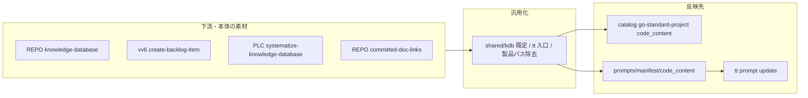

# go-standard-project テンプレートへの KDB / 文書規約プロンプト同梱と本体収束

## 背景 (Background)

`catalog/originals/axsh/go-standard-project/base/prompts/manifest/code_content/`（以下 BASE）は、新規プロジェクトへエージェント向け rules / skills / workflows の雛形を配る正本である。下流の `vv6` や `preview-legal-chkai` では、`tt kdb` / `tt kdb-track` と知識DB（KDB）まわりの capability / procedure が個別に追加・改訂されている。一方 BASE には `backlog` / `kdb` / `committed-doc-links` への言及が無く、スキャフォールド直後のプロジェクトは CLI（仕様 [026](026-Tt-Kdb-Std-And-Agent-Help.md) / [028](028-Tt-Kdb-Registry-Shared-Defaults.md)）があってもエージェント手順書が付いてこない。

調査（ローカル `tmp/investigations/2026-11-22-catalog-code-content-tt-alignment.md`。リポジトリには含まれない）の要点:

1. **`tt prompt update` の手順書（`prompt-manifest-update`）は BASE に既にあり、下流より劣っていない。** 主ギャップではない。
2. **主ギャップは KDB 最小セットと、それに紐づく文書規約・ワークフロー接続である。**
3. 下流は同じ役割でも命名が分裂している（退避: vv6 の `kdb-systematize` capability 対 PLC/REPO の `systematize-knowledge-database` procedure）。既定パスも `features/kdb/` 固定と `shared/kdb` 汎用が混在する。
4. tokotachi 本体の `prompts/manifest/code_content/`（以下 REPO）は半適用で、`pre-sync` が存在しない `scripts/kdb/*` を指し、退避 procedure / `create-backlog-item` が欠落している。

本仕様は、BASE を共通機能として更新し、同時に REPO を同じ正本へ収束させる。製品固有の coding / testing / 画面系プロンプトは取り込まない。

関連:

- [026-Tt-Kdb-Std-And-Agent-Help.md](026-Tt-Kdb-Std-And-Agent-Help.md)（`tt kdb` / `tt kdb-track` CLI）
- [028-Tt-Kdb-Registry-Shared-Defaults.md](028-Tt-Kdb-Registry-Shared-Defaults.md)（既定 `shared/kdb`、registry 欠落下の builtin backlog）
- [025-Template-Ref-Backslash-Escape.md](025-Template-Ref-Backslash-Escape.md)（`\{{kind:id}}` 記法。prompt-manifest-update の説明と整合）

---

## 要件 (Requirements)

### 必須要件

#### R1: 命名と既定パスを固定する

| 項目 | 決定 |
| :--- | :--- |
| 退避手順の ID | **`systematize-knowledge-database`**（`kind: procedure`） |
| vv6 の `kdb-systematize` | BASE / REPO には **追加しない**。役割は上記 procedure に吸収する |
| KDB 既定ルート | **`shared/kdb`**（仕様 028 と一致） |
| registry 既定 | `{kdb-root}/registry.yaml`（通常は `shared/kdb/registry.yaml`） |
| コマンド入口 | `tt kdb-track …` / `tt kdb <id> …` / `tt kdb backlog …` |
| 製品パスのハードコード | **禁止**（`features/kdb/registry.yaml` を必須とする記述、`legalchk` パス、`./scripts/kdb/*.sh` を正入口にする記述は入れない） |

本文中でプロジェクト固有の registry を示す必要がある場合は、「`--registry` / `KDB_REGISTRY` / `--kdb-root` / `KDB_ROOT` で上書きできる」と書き、一例としてのみ触れる。

#### R2: BASE に KDB 最小セットを新規追加する

次の 4 ファイルを `catalog/originals/axsh/go-standard-project/base/prompts/manifest/code_content/` に追加する。スキーマ（`capability.schema.json` / `procedure.schema.json`）の `required` を満たす frontmatter を付ける。

| パス | 役割 | 正本の起点（汎用化して取り込む） |
| :--- | :--- | :--- |
| `capabilities/knowledge-database.md` | KDB 設計の共通手順・フレームワーク核 | REPO の同名（`shared/kdb` 既定）。PLC の必須 `--registry features/...` と製品 DB 名の固定は落とす |
| `capabilities/committed-doc-links.md` | コミット文書から gitignore / 未追跡へ Markdown リンクしない規約 | REPO / PLC 共通本文 |
| `procedures/create-backlog-item.md` | 仮決定・確認・先送りを `tt kdb backlog` で残す | vv6 を土台。退避参照は `{{procedure:systematize-knowledge-database}}` |
| `procedures/systematize-knowledge-database.md` | distill → dump → merge → pack の退避 | PLC の骨格。コマンドはフラグ無し（または環境変数）の `tt kdb-track` 既定 |

`knowledge-database` は少なくとも次を含むこと（詳細の操作引数は `tt help` に委譲し、スキルへ写経しない）:

1. 四構成（ストア + 目的別 CLI + help + タイミングスキル）
2. 四段階（蓄積 → 蒸留 → 退避 → 再構築）と置き場（`{kdb-root}/<id>/data|corpus`、`tmp/kdb/<id>/`）
3. レコード UUID を参照・退避の正とする契約（テーブル ID と並列）
4. builtin `backlog` と `tt kdb-track` / `tt kdb` の入口
5. 退避 procedure 名として `systematize-knowledge-database` を指すこと
6. 遠方知識の systematize とは別系統であること

#### R3: BASE の既存ファイルを接続改訂する

| ファイル | 改訂内容 |
| :--- | :--- |
| `capabilities/portable-file-references.md` | REPO 相当: 追跡済みへの相対リンク、gitignore/`_runs` はリンク禁止、`{{capability:committed-doc-links}}` 参照 |
| `capabilities/pre-sync-knowledge-compile.md` | 遠方知識 pending に加え、Step 1b で `tt kdb-track status-all`（必要なら `systematize`）を実行。`./scripts/kdb/*` や `features/kdb/...` 固定は書かない。`systematize-knowledge-database` を references に含める |
| `capabilities/record-far-knowledge.md` | KDB 立て付け全文を遠方知識ノートに書かず、`knowledge-database` を指す注意を追加（REPO の短文） |
| `procedures/create-specification.md` | 仮決定・確認事項は `{{procedure:create-backlog-item}}` で項目化し、仕様からは `backlog:<uuid>`（インラインコード）で参照する一文を追加。提示はワークスペース相対の Markdown リンク（`file://` を付けない）に揃える |
| `procedures/create-reproducible-report.md` | **R9**: 出力先をコミット対象の `…/procedures/` から **`…/_runs/procedures/`** へ移し、**git commit しない**（PLC 相当）。詳細は R9 |
| `capabilities/prompt-manifest-update.md` | 大規模改訂は不要。テンプレート参照・エスケープ説明が仕様 025 と矛盾しないことを確認し、必要なら BASE 現行の明示的な `\{{kind:id}}` 説明を維持 |

#### R4: REPO（tokotachi 本体）を BASE と同じ正本へ収束する

`prompts/manifest/code_content/` について:

1. R2 の新規 4 ファイルを、BASE と**内容が一致するよう**追加または更新する（製品固有を REPO だけに残さない。tokotachi 固有が必要なら別 id / 別ファイルとし、本仕様の共通 id には載せない）。
2. R3 の改訂を REPO にも適用する。特に `pre-sync-knowledge-compile.md` から **死んだ** `./scripts/kdb/status-all.sh` / `systematize.sh` / `features/kdb/registry.yaml` 必須の記述を除去する。
3. `project-instructions.md` が `{{procedure:verify-and-specify-next}}` や `{{procedure:create-reproducible-report}}` を参照している場合、**参照先ファイルが存在する状態**にする（R5）、または参照を削除して参照切れを無くす。本仕様では R5 を採用する。
4. 改訂後、`tt prompt update --target all`（または少なくとも `--target cursor`）を実行し、生成物（例: `.cursor/skills/knowledge-database/SKILL.md`）が旧い `features/kdb` / `scripts/kdb` 表記のまま残らないこと。

#### R5: `verify-and-specify-next` の骨格版を BASE と REPO に追加する

- `procedures/verify-and-specify-next.md` を新規追加する。
- 骨格: 元仕様と与えられた報告（再現手順 / 調査など）を熟読し、自分で確かめ、問題があれば直しの仕様、無ければ次の仕様を `create-specification` で書く。
- 再現手順レポートやローカル検証記録の置き場は **R9 の `_runs/`** とする。次仕様（`ideas/`）から `_runs/` へ Markdown リンクを張らず、番号・ファイル名を平文で引用する（`committed-doc-links`）。
- **含めないもの**: 特定製品の画面 blueprint 必須、特定の E2E カテゴリ名の固定、特定 DB（RLS）手順の固定、`features/kdb/registry.yaml` 必須フラグ。
- backlog に触れる場合は `tt kdb backlog` と `backlog:<uuid>` に留め、採番用 Markdown `backlogs/` フォルダは使わない。
- `project-instructions.md`（BASE と REPO）の開発フローに、任意または推奨として本 procedure と（R9 改訂後の）`create-reproducible-report` への接続を書き、参照切れを作らない。

#### R6: 取り込んではいけないもの（非ゴールの明示）

次は本仕様の変更対象に**含めない**:

- REPO / PLC の `coding-rules` / `testing-rules` の製品向け全面差分（SPA・PostgreSQL 17・entitlements 等）で BASE の go-standard 骨格を置き換えること
- PLC の画面系（`design-screen-*`、`blueprint-screen-layout`）、`database-rules`、`web-security-rules`
- PLC 固有の E2E 記録パイプライン全体（`record-e2e-results`、製品フラグ `CHKAI_E2E_RECORD` 等）と `purge-procedure-artifacts`（任意要件 O3）
- vv6 の `terminology-rules` 全文（任意要件 O1 で一般化版を検討可）
- vv6 / preview-legal-chkai リポジトリ本体への追従 PR（下流は本仕様完了後の別作業）
- `tt` CLI 本体の挙動変更（026 / 028 の範囲。本仕様はプロンプト / カタログ文言と接続のみ）

**含めないものに「`_runs/` 規約そのもの」は入らない。** `_runs/` をローカル検証ログとして gitignore し、再現レポートをそこに置きコミットしないことは **R9 で必須**とする。

#### R7: 内容の機械的ガード（自動化可能な範囲）

少なくとも次を自動化テストまたは検証スクリプトで担保する（配置は実現方針に従う）:

1. BASE に R2 / R5 の必須ファイルが存在する
2. BASE の当該新規・改訂ファイル本文に、禁止パターンが含まれない  
   - 例: `features/kdb/registry.yaml` を必須とする命令調、`./scripts/kdb/` を正入口とする記述
3. BASE の当該ファイルに、期待パターンが含まれる  
   - 例: `tt kdb-track`、`shared/kdb`、`systematize-knowledge-database`、`backlog:<uuid>`（create-specification / create-backlog-item）
   - R9: `create-reproducible-report` に `_runs/procedures` があり、完了手順が **git commit しない**こと（旧 `procedures/` への commit 指示が残っていないこと）
4. カタログ側に R9 の gitignore 規則が含まれること
5. REPO の同名共通ファイルについて、BASE との差分が「許容された差異リスト」に無い限り一致する、または REPO 側も同じ禁止・期待パターン検査を通る

許容差異がある場合はテスト側に明示リストを置く。原則は **BASE = REPO（共通 id）**。

#### R8: スキャフォールド後の利用シナリオが矛盾しない

`go-standard-project` から生成した直後（registry.yaml 未作成）でも、プロンプトが指す手順が仕様 028 の CLI 挙動と矛盾しないこと:

- `tt kdb-track list` / `status-all` は registry 欠落でも成功し、builtin backlog が見える
- `create-backlog-item` は `tt kdb backlog add` を入口とし、Markdown `backlogs/` を作らない
- `pre-sync` の KDB 確認は `tt kdb-track` を呼び、存在しないシェルラッパに依存しない
- `_runs/` が gitignore され、`create-reproducible-report` がそこへ書き **commit しない**（R9）

#### R9: ブランチローカル検証ツリー `_runs/`（PLC 共通化・必須）

PLC が持つ「再現手順・ローカル検証ログをブランチ文書ツリーの `_runs/` に置き、gitignore でコミットしない」規約を、共通テンプレートへ取り込む。

**現状の充足状況（改訂前）:**

| 層 | 状態 |
| :--- | :--- |
| リンク境界（コミット文書から `_runs/` へ Markdown リンクしない） | 仕様草稿では R2 の `committed-doc-links` として **既に必須化済み**。BASE カタログ本体には未収録 |
| 出力先を `_runs/procedures/` にし **git commit しない** | **未充足**。BASE の `create-reproducible-report` は今も `…/branches/…/procedures/` へ書き **commit する** |
| スキャフォールドの `.gitignore` | **未充足**。PLC は `prompts/phases/*/branches/*/_runs/`。BASE カタログに当該規則が無い |

**必須とする内容:**

1. **gitignore**  
   `go-standard-project` のスキャフォールド成果物に、次と同等の規則を含める（ルート `.gitignore` の新設または既存への追記。カタログ originals 上の配置は実装計画で具体化する）:

   ```gitignore
   prompts/phases/*/branches/*/_runs/
   ```

2. **`create-reproducible-report` の改訂（BASE と REPO）**  
   - 正本出力先: `prompts/phases/[Phase]/branches/[Branch]/_runs/procedures/`  
   - レポートおよびその添付は **git add / git commit しない**  
   - 広い `git add prompts/phases` を使う場合も `_runs/` を stage しない旨を明記  
   - `committed-doc-links` / `portable-file-references` への参照を本文に含める  
   - 連番は `_runs/procedures` 配下を見て取る（`show_current_status` の `next_procedures_id` が `_runs` 配下を拾う前提。拾えない場合の扱いは PLC 文言に合わせ、ディレクトリ作成後の再実行を許す）

3. **文書境界のマーカー**  
   `committed-doc-links` に既にあるとおり、`prompts/phases/*/branches/*/` 直下で `_` で始まるディレクトリはローカル作業ログでありコミットしない、という説明を維持・同梱する。

4. **関連ワークフローの言い回し**  
   `project-instructions` / `verify-and-specify-next` で再現レポートの場所に触れるときは `_runs/procedures`（gitignore）とし、旧パス `branches/.../procedures/`（コミット対象）を正にしない。

**本 R9 で必須としないもの（O3）:** `_runs/e2e-tests` / `_runs/screenshots` 専用の記録 procedure、パージ用 capability。置き場の命名空間としては `_runs/` 配下に置けることを `committed-doc-links` の例で示してよいが、製品固有の記録スクリプトまではテンプレ必須にしない。

### 任意要件

#### O1: `terminology-rules` の一般化版

vv6 の原則（定着したカタカナはカタカナ、造語の漢語言い換えを避ける）だけを抜き、ドメイン固有の対訳表を一般例に差し替えた `policies/terminology-rules.md` を BASE / REPO に追加してよい。必須ではない。

#### O2: BASE に欠落している既存 procedure の REPO 復元

REPO に無く BASE にある `create-pull-request` / `create-reproducible-report` / `execute-all-after-spec` / `workflow-blueprint-design-philosophy` を、REPO へ戻す作業を本仕様に含めてよい。R5 / R9 で `create-reproducible-report` を参照・改訂する場合は、そのファイルの存在は必須（R4-3 / R5 / R9）。復元するときは **R9 適用後の本文**を置く。

#### O3: `_runs` 肥大化の掃除・E2E 記録 procedure

PLC の `purge-procedure-artifacts` や `record-e2e-results` を、製品フラグを除いた汎用版として追加してよい。必須ではない。追加する場合も `_runs/` は gitignore のままとし、コミットしない。

---

## 実現方針 (Implementation Approach)

### 概要



### 作業の単位

1. **正本ドラフト作成**（`tmp/` で差分確認してもよいが、最終成果は BASE / REPO の tracked ファイル）
2. **BASE へ新規追加（R2, R5）と改訂（R3, R9）。gitignore 規則をスキャフォールドに追加**
3. **REPO を同一内容へ揃える（R4）。欠落していた `create-reproducible-report` 等は O2 / R5 / R9 適用後本文で復元**
4. **ガードテスト追加（R7）**
5. **`tt prompt update` で生成物を更新し、コミット対象に含める**（`_runs/` 配下はコミットしない）

### 設計上の決定

| 項目 | 決定 |
| :--- | :--- |
| 退避の kind | procedure（遠方知識の `systematize-far-knowledge` と対称） |
| コマンド例の書き方 | 既定フラグ無し。上書きが必要なプロジェクトは自リポジトリの overlay で書く |
| coding / testing | BASE の go-standard 骨格を維持。製品差分は持ち込まない |
| prompt-manifest-update | 大規模変更なし。025 との整合確認のみ |
| 下流 vv6 / PLC | 本仕様の完了条件に含めない。完了後に共通部を寄せる案内はドキュメントまたは遠方知識で可 |

### 主要コンポーネント（変更対象の置き場）

- カタログ: `catalog/originals/axsh/go-standard-project/base/prompts/manifest/code_content/`
- 本体: `prompts/manifest/code_content/`
- 生成物: `.cursor/` 等（`tt prompt update` の出力。canonical は常に `code_content`）
- テスト: `tests/tt/` 配下の新規テスト、または `features/tt` / catalog 検証に近い既存パターンに合わせた単体テスト

---

## 検証シナリオ (Verification Scenarios)

1. **現状のギャップ確認（実装前）**  
   BASE に `knowledge-database.md` / `create-backlog-item.md` / `systematize-knowledge-database.md` / `committed-doc-links.md` が無いことを確認する。REPO の `pre-sync-knowledge-compile.md` が `scripts/kdb` を参照していることを確認する。

2. **BASE 追加後**  
   上記 4 ファイル（および `verify-and-specify-next.md`）が存在し、本文に `shared/kdb` と `tt kdb-track` があり、`features/kdb/registry.yaml` 必須や `./scripts/kdb/` 正入口が無いことを目視および R7 テストで確認する。

3. **接続改訂後**  
   - `portable-file-references` が `committed-doc-links` を参照する  
   - `pre-sync` に KDB Step があり、入口が `tt kdb-track` である  
   - `create-specification` に `create-backlog-item` / `backlog:<uuid>` の一文がある  
   - `project-instructions` から `verify-and-specify-next`（および参照するなら `create-reproducible-report`）へ辿れる

4. **`_runs/` 規約（R9）**  
   - スキャフォールドの gitignore に `prompts/phases/*/branches/*/_runs/` がある  
   - `create-reproducible-report` の出力先が `_runs/procedures/` であり、完了手順に git commit が無い  
   - `ideas/` から `_runs/` へリンクしない旨が `committed-doc-links` / `verify-and-specify-next` に書かれている

5. **REPO 収束後**  
   共通 id のファイルが BASE と同じ内容（または R7 の同一検査に合格）である。`tt prompt update --target cursor` 後、`.cursor/skills/knowledge-database/SKILL.md` に旧 `scripts/kdb` / 必須 `features/kdb` が残っていない。

6. **registry 無しワークスペースでの手順の読み合わせ**  
   一時ディレクトリまたは既存ワークスペースで `tt kdb-track list` が成功し builtin backlog が見えることと、`create-backlog-item` / `pre-sync` の記述が「registry 必須で失敗する」前提になっていないことを確認する（CLI 自体の回帰は 028 のテストに委ね、本シナリオはプロンプト文言の整合が主）。

7. **非ゴールの確認**  
   BASE の `coding-rules.md` / `testing-rules.md` が、legalchk / SPA 全面置換になっていないこと（差分レビュー）。

---

## テスト項目 (Testing for the Requirements)

### 要件と検証の対応

| 要件 | 自動化 |
| :--- | :--- |
| R1 / R2 / R5 ファイル存在 | 新規テストで BASE（および REPO）パスの存在断言 |
| R1 / R2 / R3 / R9 禁止・期待パターン | 同上テストで本文マッチ（`_runs/procedures`、commit 禁止を含む） |
| R4 REPO 収束 | BASE と REPO の共通 id についてバイト一致、または同一パターン検査 |
| R6 非ゴール | レビューチェックリスト。必要なら「BASE coding-rules に legalchk パスが無い」断言 |
| R7 | 本表のテストそのもの |
| R8 / R9 | プロンプト文言検査 + カタログ gitignore 検査 +（既存）`tt` の kdb-track 欠落時テストへの依存を Verification に明記 |

### ビルド・全体検証

1. ビルド＋単体テスト:

```text
scripts/process/build.sh
```

2. tt 関連の統合テスト（プロンプト / カタログ周りと KDB 既定のリグレッション）:

```text
scripts/process/integration_test.sh --categories "tt"
```

3. 本仕様で追加するガードが別パッケージの単体に置かれる場合は、`build.sh` 内の `go test` で拾われることを確認する。統合カテゴリに載せる場合は `--categories "tt" --specify` で新規テスト名を指定できること。

### 含めない検証

- vv6 / preview-legal-chkai リポジトリでの E2E
- GUI / Playwright
- `tt` の KDB 実装そのものの新規機能（028 未完分がある場合は 028 側で扱う）
