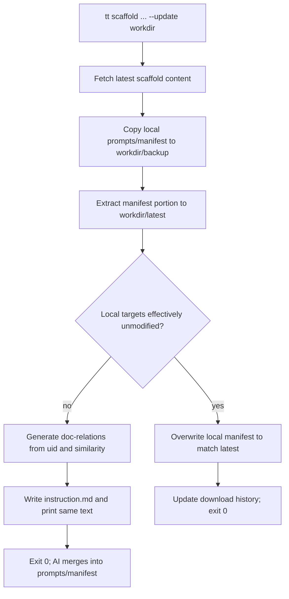

# スキャフォールド・マニフェスト更新と Agent Config Set (ACS) 支援

## 決定サマリ（レビュー確定）

| 項目 | 決定 |
| :--- | :--- |
| 暗黙タグ | 既存の `baseline` を維持。`dev` は新設しない |
| ACS 追加範囲 | B 案: ドキュメント + 非 baseline サンプル + 発見 CLI（`tt prompt tags` 相当）。選択エンジンは再実装しない |
| 安定識別子 | frontmatter `uid`（RFC 4122 UUID） |
| 文書類似度 | Character n-gram Jaccard。提示は常に上位 3 件 + スコア |
| グラム長 n | 仕様では未固定。小規模フィクスチャ比較で適度な分散を確認してから実装定数化（`backlog:ae7030f2-cf41-49f0-a709-8d3f34057272`） |

仕様時点の未決は **n の具体値のみ**（実装計画または実装初期の先送り）。それ以外の方針は本仕様で固定する。

## 背景 (Background)

### マニフェスト更新

`tt scaffold` は、初回ダウンロード後に `.kotoshiro/tokotachi/downloaded.yaml` へ履歴を書き、2 回目以降は同じカテゴリ／名前をスキップする。`--force` は履歴を無視して再ダウンロード・再適用できるが、ローカルで編集・追加した `prompts/manifest/` を壊さずに上流の更新だけ取り込む手段はない。

カタログ（例: `axsh-go-standard`）側のプロンプトは継続的に改善される一方、下流プロジェクトではスキル追加や文言のプロジェクト固有化が進む。単純上書きではローカル変更が消え、スキップのままでは上流の改善が届かない。差分を AI が解釈してマージする支援と、機械的な対応ヒント（安定 ID・類似度マップ）が必要である。

### Agent Config Set (ACS)

複数エージェント／用途ごとにプロンプトセットを分けたい需要がある。フォルダを A / B / C に複製して `tt prompt` の入出力パスで切り替える運用は、重複とドリフトのコストが高い。本来は 1 本の `prompts/manifest/` にタグを付け、compile / deploy 時に必要な集合だけ選ぶ方がよい。

調査の結果、この核は既に **Manifest Selection Tags** として実装済みである（`--tags` / `TT_TAGS`、暗黙 `baseline`、`--tag-refs`）。関連仕様: [feat-tags の 000-Manifest-Tags.md](../../feat-tags/ideas/000-Manifest-Tags.md)。本仕様の ACS 節は、製品概念としての整理と、既存実装に対する残ギャップ（発見 CLI・サンプル・ドキュメント）を埋める。暗黙タグは既存の `baseline` をそのまま使い、別途 `dev` タグを定義しない（`backlog:02bee65a-49a3-4945-8e10-18d2e23ac2c0`）。追加範囲は B 案（ドキュメント＋非 baseline サンプル＋発見 CLI）で確定した（`backlog:85d5fd04-4028-47ff-87ba-f20b69b41773`）。

---

## 要件 (Requirements)

### A. マニフェスト更新機能（必須）

#### A1. `--update` オプション

- `tt scaffold <category> <name> --update [workdir]` を追加する。
- 例: `tt scaffold project axsh-go-standard --update tmp/update/`
- `workdir` 省略時の既定は `tmp/scaffold-update/<category>-<name>/` とする（gitignore 対象の作業領域）。
- `--update` と通常の初回適用・履歴スキップ・`--force` の関係:
  - 通常（フラグなし）: 現行どおり。履歴があればスキップ。
  - `--force`: 現行どおり。履歴無視で再ダウンロードし、スキャフォールド適用ルールに従って書き込む（AI マージ支援はしない）。
  - `--update`: 履歴があっても最新コンテンツを取得し、下記の更新ワークスペースを用意する。ローカル `prompts/manifest/` を直接破壊的に上書きしない（クリーン更新パスを除く）。

#### A2. 更新ワークスペースのレイアウト

`workdir` 配下に少なくとも次を用意する。

| パス | 内容 |
| :--- | :--- |
| `backup/` | 更新開始時点のローカル `prompts/manifest/`（対象範囲）のコピー |
| `latest/` | カタログから取得した最新スキャフォールドのうち、マニフェスト相当の展開結果 |
| `instruction.md` | AI 向けマージ指示（英語の方針本文を含む） |
| `doc-relations-NNN.md`（連番、1 件でも `001` から） | `backup` 視点の対応表（uid 一致・類似上位） |

遠方知識など更新対象外とするプレフィックス（例: ファイル名または id が `__far-knowledge-` で始まるもの）は、対応表の主対象から除外してよい。除外規則は実装時に明文化し、`instruction.md` にも書く。

#### A3. CLI 応答が AI への指示になること

- `tt` は標準出力（または標準エラーと明確に分離した主応答）に、`instruction.md` と同等のマージ指示を出す。
- あわせて「指示ファイルをどこに保存したか」を補足する。
- エージェントは追加の説明を待たず、その応答／`instruction.md` に従って `prompts/manifest/` を更新できること。

#### A4. クリーン更新パス（ローカル未編集）

- `backup` 側の対象ファイルが、前回スキャフォールド由来の内容から実質未編集である場合（判定方法は実現方針）、AI マージを要求せず、`latest` の内容でローカル `prompts/manifest/` を最新と同一状態に揃えてよい（不足の追加・余剰の削除を含む）。
- 未編集判定に失敗した場合、または 1 ファイルでもローカル固有変更がある場合は、クリーン更新せずワークスペース生成＋指示出力に進む。

#### A5. マージ方針（instruction.md の必須内容）

`instruction.md` は英語で、少なくとも次の方針を含めること。

1. Do not discard or rewrite project-specific information without cause.
2. Prefer incorporating improvements and convenience from `latest/`.
3. Do not break existing references (`uses_capabilities`, template refs, relative links, skill ids).
4. Keep current behavior working while absorbing upstream improvements.
5. Use `doc-relations-NNN.md` (zero-padded sequence starting at 001, even when only one file) as mechanical hints; do not invent renames that contradict uid matches.
6. After merging into the real `prompts/manifest/`, leave the workdir intact for review unless the user asks to delete it.

#### A6. Frontmatter `uid`（安定識別子）

- code_content 系マニフェスト（少なくとも policy / procedure / capability / skip）の frontmatter に任意（導入後はカタログ正本では必須化を目指す）の `uid` を定義する（`backlog:b7c00a38-db8d-4b8c-948f-e94f860db404`）。
- 値は RFC 4122 UUID 文字列。一度発行したらカタログ上で変更しない。
- ファイル名や `id` が変わっても、同じ `uid` なら同一ドキュメントとみなす。
- スキーマ（プロジェクトおよび `catalog/originals/axsh/go-standard-project` 側）を更新する。
- 既存ローカルファイルに `uid` が無い場合の扱いは `doc-relations` と instruction に明記する（類似度フォールバック、または初回マージ時の付与）。

#### A7. 文書対応表（doc-relations）

- `backup` の各対象ファイルについて、少なくとも次を機械生成する。
  - `uid` 一致する `latest` 側パス（あれば）
  - `uid` 不一致／欠落時の類似ドキュメント上位 3 件（スコア付き）
- 出力ファイル名は **最初から連番前提** とする。分割の有無に依らず、形式は `doc-relations-NNN.md`（ゼロ埋め 3 桁、`001` 始まり）。件数が 1 でも `doc-relations-001.md` のみとし、分割無し用の `doc-relations.md` は置かない。
- 件数が増えて複数ファイルになる場合も同じ連番を継続し、`instruction.md` から各 `doc-relations-NNN.md` へリンクする。
- 類似度アルゴリズムは **Character n-gram Jaccard** とする（`backlog:2752d038-bdd8-4920-91af-fa6fc32b01e4`）。LLM および重い外部 NLP 依存は使わない。
- **n（グラム長）は仕様時点では固定しない。** 実装計画または実装初期に、小規模フィクスチャ比較プロセス（実現方針参照）で選び、選んだ n をコード定数または設定として固定し、単体テストに残す。
- 既定の提示は閾値カットではなく **常に上位 3 件＋スコア** とする（自動マージの唯一根拠にはしない）。

#### A8. ダウンロード履歴との関係

- `--update` 成功後（クリーン更新完了、または更新ワークスペースの準備完了）は、当該スキャフォールドのダウンロード履歴を更新してよい。
- `--update` は「スキップ」してはならない。常に最新取得を試みる。

### B. Agent Config Set (ACS) 支援

追加範囲は **B 案** で確定する。タグ選択エンジンの再実装はせず、既存 Manifest Selection Tags の上に運用面を足す。

#### B1. 既存機能の位置づけ（必須・前提）

次を ACS の核として公式に位置づける（新規再実装はしない）。

- Frontmatter `tags`（省略時は暗黙 `baseline`）
- `tt prompt compile|deploy|update --tags a,b,...`（OR 選択）
- 環境変数 `TT_TAGS` / `TT_TAG_REFS`
- `--tag-refs include|strict`

無指定時は既定どおり `baseline` が選ばれていると解釈する。`dev` タグの新設や暗黙タグの改名は行わない（`backlog:02bee65a-49a3-4945-8e10-18d2e23ac2c0`）。

#### B2. 製品ドキュメント（必須）

- ACS とは「単一の manifest ツリーをタグでエージェント／用途別に切り出す運用」であること、および ACS の入口が既存の `--tags` / `TT_TAGS` と発見 CLI（B3）であることを、prompt 関連ヘルプおよび capability（例: `prompt-manifest-update` 周辺）に短く記載する。
- フォルダ複製セット（A/B/C）よりタグ選択を推奨する旨を書く。
- CLI ヘルプに ACS という呼称をシノニムとして追記する（例: `tt help prompt` に「ACS: selection via --tags」）。

#### B3. 発見 CLI（必須）

- `tt prompt tags`（名称はこの程度でよい。実装計画で最終確定）を追加する。
- 少なくとも次を出力する。
  - マニフェスト上に現れるタグ名の一覧（暗黙 `baseline` を含む解釈を明示）
  - 各タグに属する code_content エンティティ（kind / id / 相対パス）
- 読み取り専用であり、compile / deploy は行わない。
- `--workspace` / `--prompts-dir` など既存の path フラグと整合させる。

#### B4. 非 baseline サンプル（必須）

- カタログ（`catalog/originals/axsh/go-standard-project`）に、`baseline` 以外のタグを持つ最小サンプルを 1 セット以上置く。
- 例: `editor-only`（エディタ向けのみ）や `external-agent`（エディタ外エージェント向け）など。タグ名は実装計画で最終確定してよい。
- サンプルは「フォルダを分けずタグで切り替える」使い方の見本とし、手順書（B2）から参照できるようにする。
- 既存の `baseline` のみのエンティティの挙動は変えない。

---

## 実現方針 (Implementation Approach)

### マニフェスト更新フロー

### コンポーネント概要

1. **CLI (`features/tt/cmd/scaffold.go`)**  
   `--update` と任意の workdir 引数を受け、scaffold パッケージへ渡す。

2. **Update workspace builder (`pkg/scaffold` または隣接パッケージ)**  
   backup / latest の展開、クリーン判定、`instruction.md` / `doc-relations-NNN.md`（連番）生成。

3. **uid スキーマ**  
   `prompts/manifest/schemas/*.json` とカタログ側スキーマへ `uid` を追加。カタログ originals の各 frontmatter に UUID を付与する生成／検証手順を用意する。

4. **Similarity mapper（Character n-gram Jaccard）**  
   Go で決定論実装する。正規化（改行・空白の扱いなど）は実装計画で固定し、テストで固定する。  
   **n 選定プロセス（必須）:**
   1. 小規模フィクスチャを用意する。少なくとも次の対を含める。
      - 同一文書の軽微編集（高スコア期待）
      - リネーム相当（本文は近いが高スコア期待）
      - 無関係な別文書（低スコア期待）
      - 共通 frontmatter／定型見出しだけ似ている別文書（誤って高スコアになりすぎないこと）
   2. 候補 n（少なくとも 3, 4, 5）で各対の Jaccard を計算する。
   3. **適度な分散**を満たす n を選ぶ。ここでの分散とは、正しい対応のスコアが誤対応より明確に高く、スコアが全部 0.9 付近や全部 0.1 付近に潰れていないこと。
   4. 選んだ n を実装に固定し、フィクスチャ比較を回帰テスト（または計画書に結果表＋単体テスト）として残す。

5. **ACS（B 案）**  
   既存 `tags.go` の選択ロジックは維持する。追加は (1) `tt prompt tags` 相当の列挙、(2) カタログの非 `baseline` サンプル、(3) ACS 呼称付きヘルプ／capability 文書。

### `--force` との役割分担

| 用途 | フラグ |
| :--- | :--- |
| 壊れてよい／未編集前提で丸ごと取り直す | `--force` |
| ローカル変更を保ちつつ上流を取り込む | `--update`（AI マージ） |
| 未編集なら自動で latest に揃える | `--update` のクリーンパス |

### クリーン判定（仮）

対象パス集合について、ローカル内容と「前回適用相当」または「backup と latest の共通祖先相当」の比較が難しい場合の実用案:

- 第 1 段階: ローカル各ファイルの内容ハッシュが `latest` と全一致、かつローカルにのみ存在する対象外ファイルが無い → 既に最新。
- 第 2 段階: ダウンロード履歴の時点スナップショットが無い場合、クリーン自動適用は行わず、常にワークスペース＋指示へ進む（安全側）。

実装計画で判定を厳密化する。誤ってローカル固有ファイルを消さないことを優先する。

---

## 検証シナリオ (Verification Scenarios)

### シナリオ 1: 未編集プロジェクトでのクリーン更新

1. 一時ディレクトリに `tt scaffold project axsh-go-standard --yes`（または同等）でマニフェストを展開する。
2. `prompts/manifest/` を編集しない。
3. カタログ側に差分がある状態をシミュレートする（テスト用フィクスチャで `latest` 相当を差し替えてもよい）。
4. `tt scaffold project axsh-go-standard --update tmp/update/` を実行する。
5. クリーンパスが選ばれた場合、ローカル `prompts/manifest/` が latest と一致し、余剰が削除されていることを確認する。
6. クリーンパスが安全側で選ばれなかった場合でも、`tmp/update/backup`・`latest`・`instruction.md`・少なくとも `doc-relations-001.md` が生成され、stdout に指示と保存先が出ることを確認する。単一ファイルでも `doc-relations.md`（連番なし）は作られないこと。

### シナリオ 2: ローカル編集ありの AI マージ支援

1. シナリオ 1 と同様に初期展開する。
2. ローカルで既存 capability の本文を追記し、新規スキルファイルを 1 つ追加する。
3. `latest` 側では別の既存ファイルが改善され、さらに 1 ファイルがリネームされている（`uid` は同一）フィクスチャを用意する。
4. `--update tmp/update/` を実行する。
5. ローカル `prompts/manifest/` は自動では壊れていない。
6. `tmp/update/instruction.md` が英語のマージ方針を含み、`doc-relations-001.md`（必要なら後続連番）が uid 一致でリネームを示し、類似上位が出力される。
7. stdout の指示内容がファイルと整合し、保存先パスが示される。
8. 指示に従ったマージ（人手またはテスト用の決定的フィクスチャ適用）後、プロジェクト固有追記が残り、latest の改善が取り込まれ、参照が壊れない。

### シナリオ 3: uid と類似度

1. `uid` 付き 2 ファイルを backup / latest に置き、latest 側だけパスを変える。
2. 対応表で uid 一致として結ばれることを確認する。
3. `uid` 無しの改名・軽微編集ペアを用意し、Character n-gram Jaccard の上位 3 件に期待ファイルが含まれることを確認する。
4. n 選定用フィクスチャで、正しい対応のスコアが無関係文書より明確に高い（適度な分散）ことを確認する。
5. `__far-knowledge-` 対象が主表から除外されることを確認する。

### シナリオ 4: ACS（既存タグ＋発見 CLI＋サンプル）

1. 同一 manifest ツリーに `tags: [baseline]` と非 baseline（例: `external-agent`）の capability を置く。
2. `tt prompt compile --tags baseline` では後者が selected にならない（参照モードに注意）。
3. `tt prompt compile --tags external-agent` では後者が選ばれる。
4. `--tags` 省略時は baseline 相当になる。
5. `tt prompt tags` が両タグと所属エンティティを列挙する。
6. カタログ由来の非 baseline サンプルが scaffold 後に存在し、手順書またはヘルプから辿れる。
7. フォルダを複製せずにセット切替できることを確認する。

### シナリオ 5: 履歴スキップとの共存

1. 通常の 2 回目 `tt scaffold project axsh-go-standard` は引き続きスキップされる。
2. 同じ状態で `--update` を付けるとスキップされず、取得処理に入る。

---

## テスト項目 (Testing for the Requirements)

### ビルド・全体検証

1. ビルド＋単体テスト:
   `scripts/process/build.sh`

2. scaffold / prompt 関連の統合テスト（`tests/tt`）:
   `scripts/process/integration_test.sh --categories "tt" --specify "Scaffold|PromptTags|PromptUpdate|ManifestUpdate|ACS|DocRelations|Uid|PromptTagsList"`

3. タグ既存回帰と発見 CLI:
   `scripts/process/integration_test.sh --categories "tt" --specify "PromptTags"`

### 要件とテストの対応

| 要件 | 検証 |
| :--- | :--- |
| A1 `--update` CLI | 単体（フラグ解析）＋ `tests/tt` で workdir 生成を検証 |
| A2 レイアウト | 統合テストで backup / latest / instruction / `doc-relations-001.md`（連番）の存在を検証。連番なしの `doc-relations.md` が無いこと |
| A3 stdout 指示 | 統合テストで出力に方針キーワードと保存先が含まれることを検証 |
| A4 クリーン更新 | フィクスチャ付き単体／統合で上書き・削除を検証。安全側スキップも検証 |
| A5 方針文言 | `instruction.md` の必須英語フレーズをスナップショットまたは部分一致で検証 |
| A6 `uid` | スキーマ検証テスト、カタログ付与の検査、uid 一致マッピング単体テスト |
| A7 doc-relations | Character n-gram Jaccard の単体テスト（決定論）＋上位 3 件。n 選定フィクスチャで分散（正対応 ≫ 誤対応）を検証し、採用 n を固定 |
| A8 履歴 | `--update` 後にスキップされないこと／履歴更新の単体テスト |
| B1 既存 ACS 核 | 既存 `PromptTags` 系テストの継続成功 |
| B2 ドキュメント | ヘルプまたは capability 本文に ACS 説明・`--tags` 案内が含まれることの検査 |
| B3 発見 CLI | `tt prompt tags` の単体／統合テスト（タグ一覧と所属の期待値） |
| B4 非 baseline サンプル | カタログ検査＋ scaffold 後にサンプルが残ることの統合テスト |

手動の目視だけを完了条件にしない。上記スクリプトによる自動検証を必須とする。

---

## 関連・仮決定・確認事項

| 項目 | 参照 |
| :--- | :--- |
| 既存タグ仕様 | [000-Manifest-Tags.md](../../feat-tags/ideas/000-Manifest-Tags.md) |
| 暗黙タグ `baseline` 維持（`dev` 不要） | `backlog:02bee65a-49a3-4945-8e10-18d2e23ac2c0`（決着） |
| frontmatter 安定識別子は `uid` | `backlog:b7c00a38-db8d-4b8c-948f-e94f860db404`（決着） |
| 類似度は Character n-gram Jaccard（n はフィクスチャ比較） | `backlog:2752d038-bdd8-4920-91af-fa6fc32b01e4`（決着） |
| n（グラム長）のフィクスチャ比較と固定 | `backlog:ae7030f2-cf41-49f0-a709-8d3f34057272`（先送り） |
| ACS 追加範囲は B 案 | `backlog:85d5fd04-4028-47ff-87ba-f20b69b41773`（決着） |

---

## 非目標 (Non-Goals)

- `--update` 実行中に LLM API を呼び出して自動マージまで完了すること（指示とヒントの生成までが `tt` の責務）。
- memory 文書や safety / targets のタグ選択モデルの変更。
- 既存 `--force` の意味の置き換え。
- 暗黙タグ名の `dev` への改名、および `dev` タグの新規定義。
